[简体中文](README.md) · [繁體中文](README.zh-TW.md) · **English** · [Tiếng Việt](README.vi.md) · [ไทย](README.th.md)

# OneFilm

> **Turn your TV into a private cinema for the whole family.**

OneFilm is a video player built for **Android TV, TV boxes, and large phone screens**. It brings video-on-demand, live TV, aggregated search, favorites and resume playback, subtitles, danmaku, and remote-control navigation into one clean big-screen interface, so you don't have to switch back and forth between apps.

If you already have a legal media source, a TVBOX-compatible config, or live channel sources, OneFilm is the player that presents that content properly: poster walls big enough, search fast enough, a remote that feels natural, and an interface that grandparents and kids can use with ease.

## At a glance

- **One place for everything you want to watch**: movies, series, variety shows, anime, and live TV, all in the same TV interface.
- **TVBOX-compatible playback**: import TVBOX / CatVod style media and live sources. You provide the sources yourself.
- **Built for the TV**: large text, large posters, and a clear focus highlight, so everything works from the sofa with a remote.
- **Looks good, works well**: a clean, bright interface, smooth card animations, nothing in the way. Open it and watch.
- **Comfortable viewing**: subtitles, audio tracks, aspect ratio, playback speed, danmaku, and more playback settings.
- **Pick up where you left off**: favorites, watch history, and resume points are all saved, so changing episodes or sources doesn't mean searching again.
- **Five languages, one tap away**: Simplified Chinese, Traditional Chinese, English, Tiếng Việt, and ไทย. Switch them in Settings.

## What it does

### Your living-room media hub

Bring your usual media sources together in one player. The home screen is a clear poster wall, with categories, filters, rankings, and search close at hand, so finding something takes no complicated steps.

### On-demand and live TV in one app

Browse movies, TV series, variety shows, and anime by category, and switch live channels by channel group. One app covers the different viewing habits of a whole family.

### Aggregated search that saves time

Type a title and search several content sources at once. Results are grouped by source, so you can tell at a glance which line plays and which one runs more smoothly.

### A big-screen remote experience

Every button and card is optimized for the remote: clear focus, smooth movement, and a back path that never gets lost. This is not a phone interface simply blown up, but an interaction truly designed for TV.

### Comfortable for long sessions

Adjust subtitle style and position, switch audio tracks, change aspect ratio and playback speed, and turn danmaku on or off. During full-screen playback the controls hide automatically: the OK key pauses, and the left and right keys rewind and fast-forward.

### Make the TV yours

Theme, wallpaper, sources, and playback preferences can all be adjusted to your own habits. Simple, bright, or dark — use whichever you like.

### Five interface languages

Menus, settings, player controls, network storage, and messages all support **Simplified Chinese, Traditional Chinese, English, Tiếng Việt, and ไทย**. Switching in "Settings → Language" takes effect immediately, and TV and mobile share the same strings; changing the language does not affect your source configuration, favorites, or watch history.

## Made for these situations

- You have an Android TV or TV box at home and want one unified place for movies, series, and live TV.
- You already have legal TVBOX / media sources but want a nicer, easier player.
- You don't want to study complex settings — just install, import a source, and sit down to watch.
- You like big poster walls, remote-control focus, and the "open it and keep watching" experience.

## Getting started

1. Download the latest APK from [GitHub Releases](https://github.com/Viciy2023/Onefilm/releases/latest):
   - TV / box: `OneFilm-TV-*.apk`
   - Phone / tablet: `OneFilm-Mobile-*.apk`
2. Open OneFilm after installing it.
3. Import your own legal media/live sources in "Config" or "Settings".
4. Go back to the home screen and search or browse for what you want to watch.

> System requirement: **Android 7.0 or later**.

## Interface preview

| Home | Categories |
|---|---|
|  | 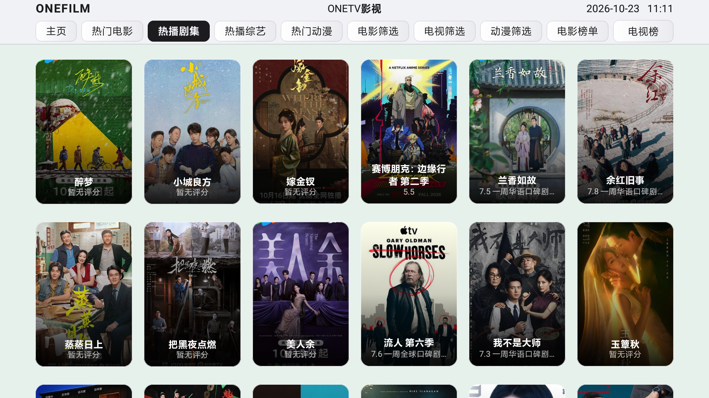 |

| Search | Search results |
|---|---|
| 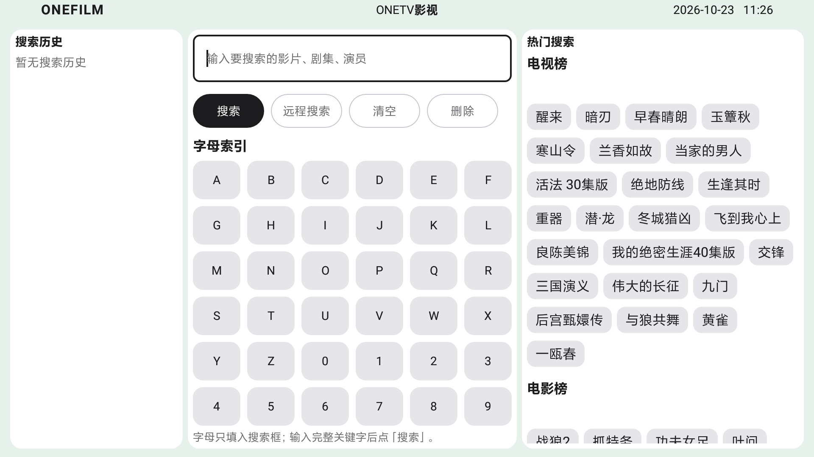 | 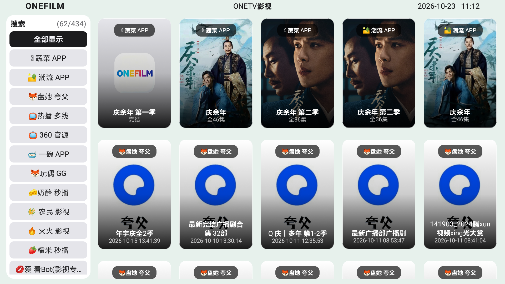 |

| History | Settings |
|---|---|
| 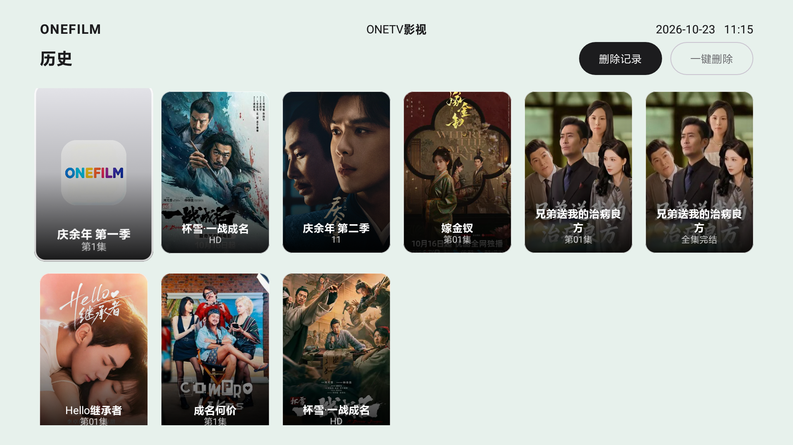 | 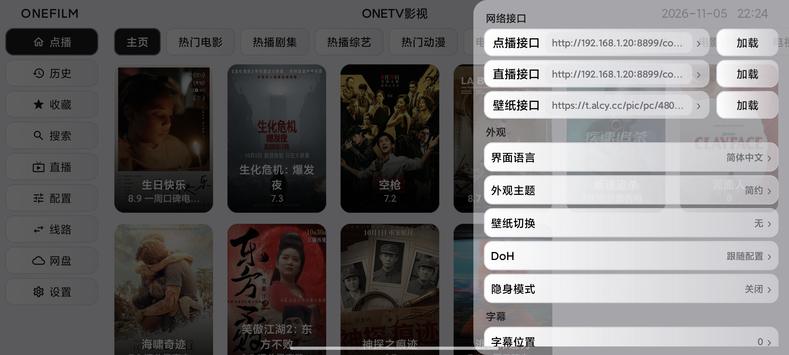 |

| Details | Playback |
|---|---|
| 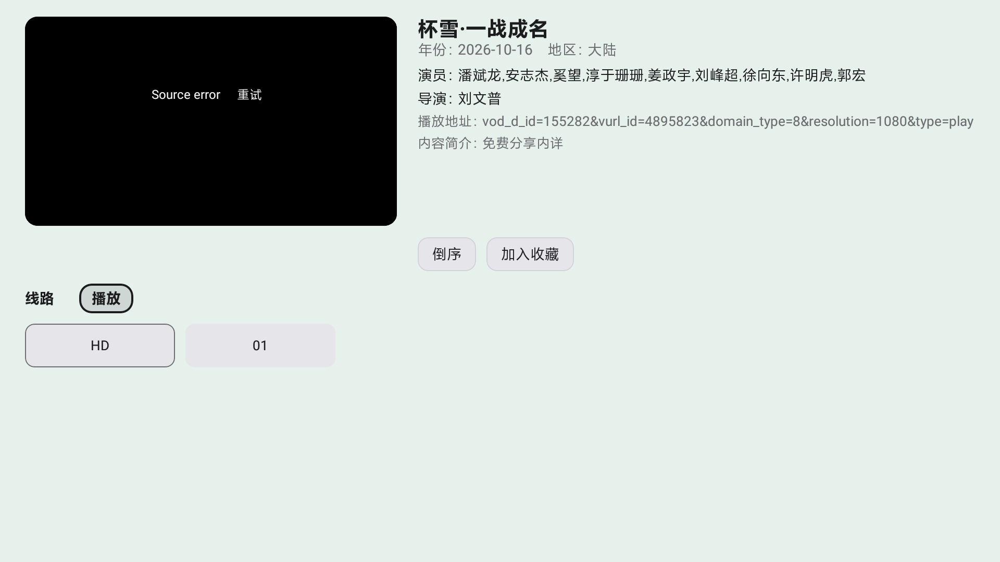 |  |

### Mobile interface

| Home | Search |
|---|---|
| 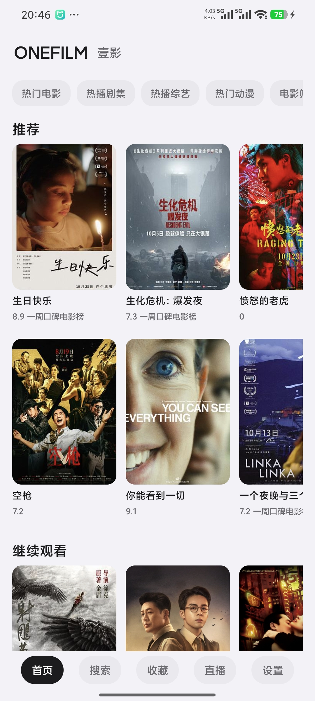 | 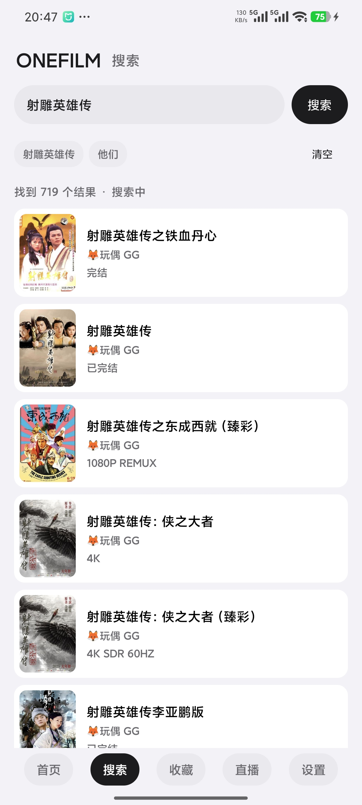 |

| Favorites | History |
|---|---|
| 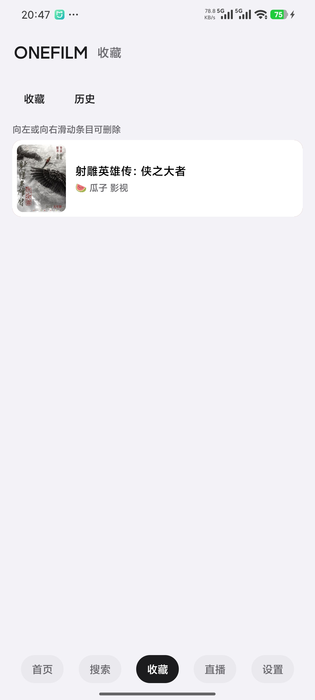 | 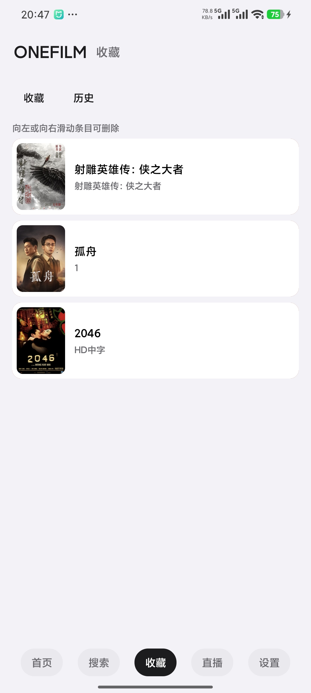 |

| Movie details | Category filter |
|---|---|
| 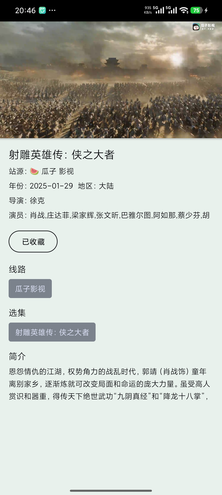 | 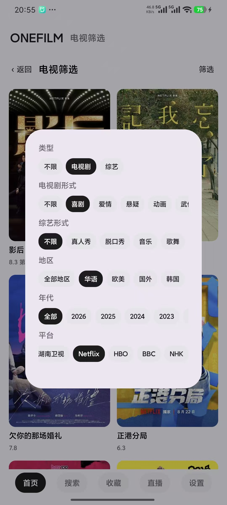 |

| Settings | Categories |
|---|---|
| 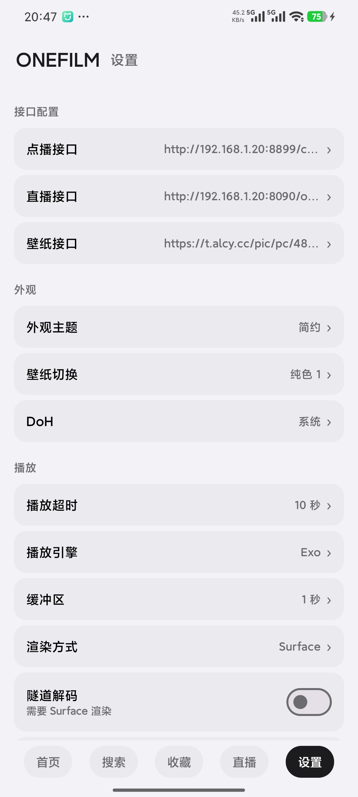 | 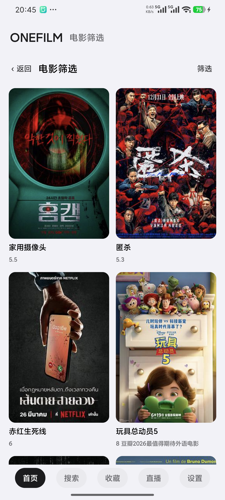 |

> Screenshots are only for showing the interface and for development testing. Movies, posters, and source addresses are all demo content; the official release does not include any media resources or working sources.

## Performance and memory

Aggregated search creates a large number of temporary script engines, and how that memory is recycled decides whether low-end devices stay stable. Starting with 0.1.22, engine recycling uses per-site release, active protection, a fallback trim every 10 sites, and forced release for timed-out sites.

Measured on the same device with five consecutive full searches:

| Scenario | Before | After |
|---|---:|---:|
| Peak native during search | 765 MB | 281 MB |
| Peak total memory (PSS) during search | 1.06 GB | 537 MB |
| Time spent at peak | 30–40 s | 4–6 s |
| Native while playing after search | 743 MB | 116 MB |
| Total memory while playing after search | 1.01 GB | 366 MB |
| Total memory after leaving the player | 814 MB | 354 MB |
| Native 60 s after search | 177 MB | 115 MB |

Notes:

- The player itself is cheap: playing right after a cold start adds about 20 MB. Most of the pressure comes from temporary engines during search.
- Memory is released much earlier, so **TVs and boxes with 2 GB / 3 GB of RAM are far less likely to be reclaimed by the system while searching or switching episodes**, which means fewer stalls and fewer surprise exits.
- Data comes from a single 11.4 GB device with a fixed interface and fixed keywords; results vary with the number of sites, interface type and network conditions.

## Notes

OneFilm **does not provide, does not bundle, and does not ship** any media content, live sources, or working on-demand/live sources. It is only a player shell: you need to prepare and configure legal content sources yourself, and you are responsible for the sources you use. Do not use this software to distribute infringing content or for purposes that violate local laws and regulations.

## Origin and license

OneFilm is a derivative work based on the `fongmi` branch of [FongMi/TV](https://github.com/FongMi/TV), and continues to use the **GPL-3.0** license.

- Upstream project: [FongMi/TV](https://github.com/FongMi/TV)
- Upstream initial commit: `0af3b31a1783b8fa4f0ce12e52ac9fad78ddfb1e`
- License: [LICENSE.md](LICENSE.md)
- Third-party and upstream notices: [NOTICE](NOTICE)

Thanks to the upstream project and all open-source contributors. OneFilm keeps the upstream origin and copyright notices, and also keeps your freedom to configure legal sources yourself.
