**简体中文** · [繁體中文](README.zh-TW.md) · [English](README.en.md) · [Tiếng Việt](README.vi.md) · [ไทย](README.th.md)

# 壹影 OneFilm

> **把电视，变成全家人的私人影院。**

壹影 OneFilm 是一款为 **Android TV、电视盒子和手机大屏** 打造的影视播放器。它把点播、直播、聚合搜索、收藏续播、字幕、弹幕和遥控器操作收进一个清爽的大屏界面里，让你不用在多个 App 之间来回切换。

如果你手里有合法的影视接口、TVBOX 兼容配置或直播源，壹影就是那个负责把内容“好好呈现出来”的播放器：海报墙够大、搜索够快、遥控器够顺手，老人和孩子也能轻松使用。

## 一眼看懂

- **一个入口，装下想看的内容**：电影、剧集、综艺、动漫、直播，在同一个电视界面里浏览。
- **TVBOX 兼容接口播放**：支持导入 TVBOX / CatVod 风格的影视与直播接口，接口由用户自行提供。
- **为电视而生**：大字号、大海报、明确的焦点高亮，坐在沙发上用遥控器就能完成所有操作。
- **好看，也好用**：简洁明亮的界面、流畅的卡片动效、没有多余打扰，打开就能看。
- **看得舒服**：支持字幕、音轨、画面比例、倍速、弹幕和多种播放设置。
- **视频广告过滤**：自动识别并跳过 m3u8 贴片广告，规则未覆盖的源也能靠 URL 特征与 PTS 时间轴连续性兜底。
- **弹幕**：兼容常规弹幕接口，也可自定义弹幕 API；播放时按片名与集数自动匹配，支持公益或自建节点。
- **下一次接着看**：收藏、观看历史和续播记录都在，换集、换线路不用重新找。
- **五种语言，随手切换**：简体中文、繁體中文、English、Tiếng Việt、ไทย，设置里一键切换。
- **海报两种样式**：竖版海报墙之外新增横版 16:9 样式；在「设置 → 外观 → 海报样式」切换后，首页、分类、搜索、收藏、历史统一生效。

## 它能做什么

### 弹幕

兼容常规弹幕接口，也可以在设置里填写自定义弹幕 API。播放时按片名与集数自动匹配，支持公益节点或自建服务。

### 客厅里的影视入口

把常用的影视接口集中到一个播放器里。首页是清晰的海报墙，分类、筛选、榜单和搜索都在手边，找片不需要复杂操作。

### 点播与直播，一机搞定

电影、电视剧、综艺、动漫可以按分类浏览；直播频道可以按频道组切换。一个 App，覆盖一家人不同的观看习惯。

### 聚合搜索，少走弯路

输入片名就能同时搜索多个内容源，结果按来源展示，哪条线路能播、哪条更流畅，一眼就能判断。

### 大屏遥控器体验

所有按钮和卡片都为遥控器优化：焦点清楚、移动顺滑、返回不迷路。不是把手机界面简单放大，而是真正适合电视的交互。

### 看得久，也看得舒服

支持字幕样式与位置调整、音轨切换、画面比例、播放速度、弹幕开关等常用功能；全屏播放时控件自动隐藏，确认键暂停，左右键快进退。

### 个性化你的电视

主题、壁纸、接口和播放偏好都可以按自己的习惯调整。简洁、明亮、暗黑，喜欢哪种就用哪种。

### 五种界面语言

菜单、设置、播放器控制、网盘与提示信息均已支持 **简体中文、繁體中文、English、Tiếng Việt、ไทย**。在“设置 → 语言”中切换后立即生效，TV 端与手机端使用同一套文案；切换语言不会影响接口配置、收藏和观看历史。

## 适合这些场景

- 家里有 Android TV 或电视盒子，希望用一个统一入口看电影、追剧、看直播。
- 已经拥有合法 TVBOX / 影视接口，但想要一个更漂亮、更顺手的播放器。
- 不想研究复杂设置，只想安装、导入接口、然后坐下来看。
- 喜欢大屏海报墙、遥控器焦点和“打开就能继续看”的体验。

## 开始使用

1. 从 [GitHub Releases](https://github.com/Viciy2023/Onefilm/releases/latest) 下载最新版 APK：
   - 电视/盒子：`OneFilm-TV-*.apk`
   - 手机/平板：`OneFilm-Mobile-*.apk`
2. 安装后打开壹影。
3. 在“配置”或“设置”中导入你自己的合法影视/直播接口。
4. 回到首页，搜索或浏览想看的内容。

> 系统要求：**Android 7.0 及以上**。

## 性能与内存

聚合搜索会临时创建大量脚本引擎，这部分内存管理直接决定低配设备能否稳定运行。0.1.22 起，引擎回收改为「单站释放 + 活跃保护 + 每 10 个站点兜底回收」，并补充了超时站点的强制回收。

同一台设备、站点总数 313、连续 5 次全量搜索的实测对比：

| 场景 | 优化前 | 优化后 |
|---|---:|---:|
| 搜索期 Native 峰值 | 765 MB | 281 MB |
| 搜索期总内存（PSS）峰值 | 1.06 GB | 537 MB |
| 高内存占用持续时间 | 30–40 秒 | 4–6 秒 |
| 搜索后播放 Native | 743 MB | 116 MB |
| 搜索后播放总内存 | 1.01 GB | 366 MB |
| 退出播放后总内存 | 814 MB | 354 MB |
| 搜索结束 60 秒后 Native | 177 MB | 115 MB |

补充说明：

- 播放器本身开销很小：冷启动直接播放只增加约 20 MB，压力主要来自搜索期的临时引擎。
- 内存更早回落，意味着 **2 GB / 3 GB 内存的电视和盒子在连续搜索、切换剧集时更不容易被系统回收**，卡顿和“看到一半被退出”的概率更低。
- 数据来自单台 11.4 GB 设备、固定接口与固定关键词；不同站点数量、接口类型和网络状况会有差异。

### 电视实测（2 GB 内存 / Android 9）

在 2 GB 内存的小米电视（Android 9）上，用同样的 313 个站点重复 5 次搜索 + 播放：

| 场景 | 应用 PSS | Native | 系统可用内存 |
|---|---:|---:|---:|
| 首页空闲 | 104 MB | 20 MB | 800 MB |
| 5 次搜索峰值 | 303 MB | 156 MB | 677 MB |
| 搜索结束 60 秒 | 197 MB | 53 MB | 778 MB |
| 搜索后播放 | 209 MB | 52 MB | 650–758 MB |
| 切到后台 | 192 MB | 53 MB | 700 MB |

全程没有被系统杀进程，系统可用内存最低约 677 MB，说明在 2 GB 设备上仍有足够余量。

## 界面预览

| 首页 | 分类 |
|---|---|
|  | 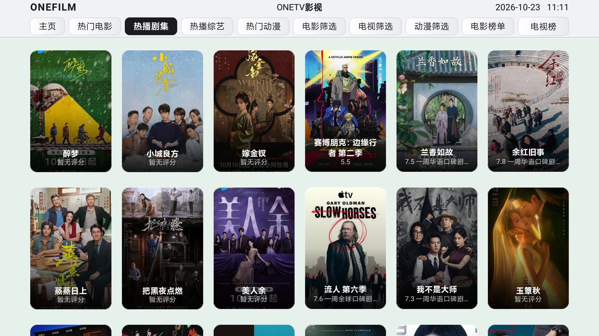 |

| 横版首页 | 横版搜索 |
|---|---|
|  | 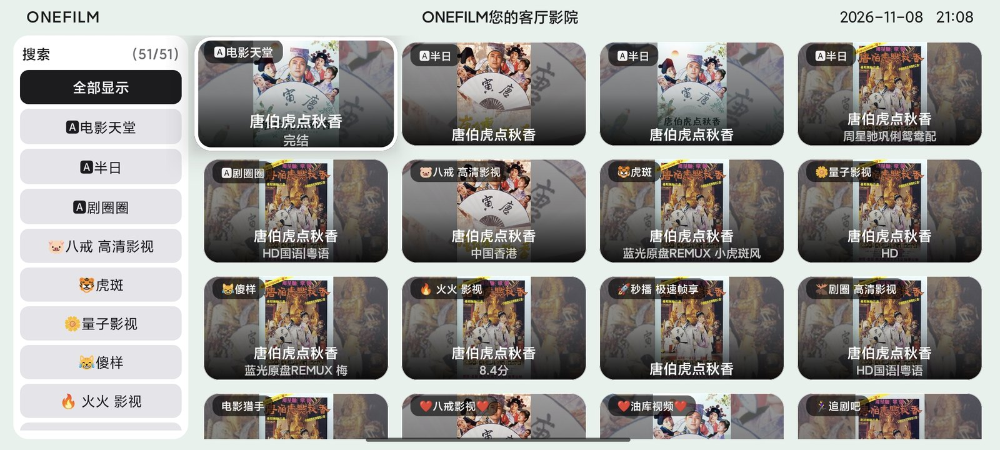 |

| 搜索 | 搜索结果 |
|---|---|
| 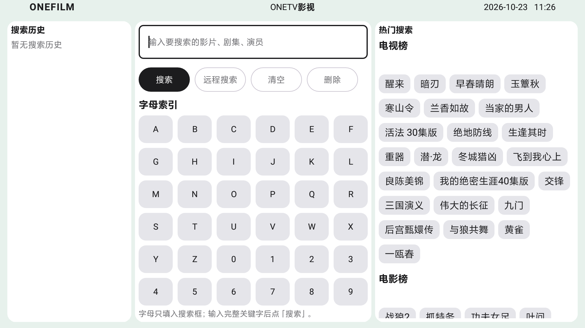 | 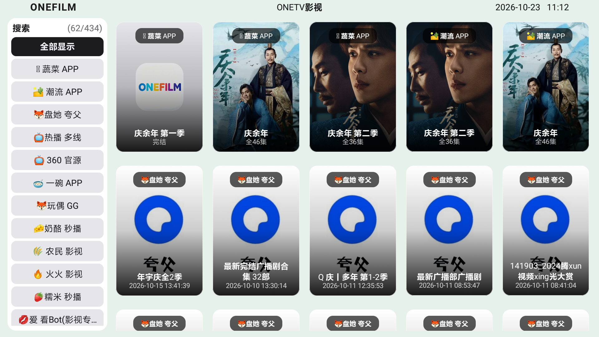 |

| 历史 | 设置 |
|---|---|
|  | 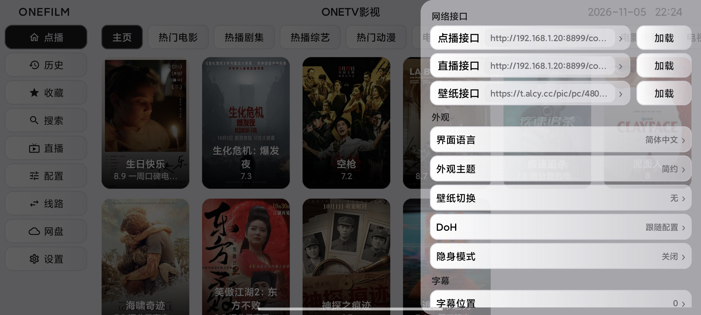 |

| 详情 | 播放 |
|---|---|
| 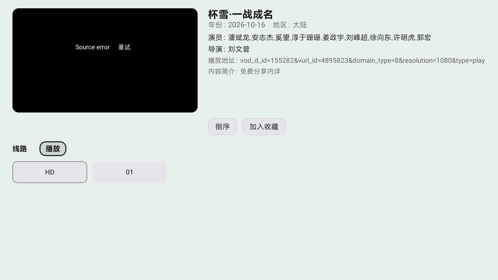 |  |

| 大屏弹幕 | 小窗弹幕 |
|---|---|
|  | 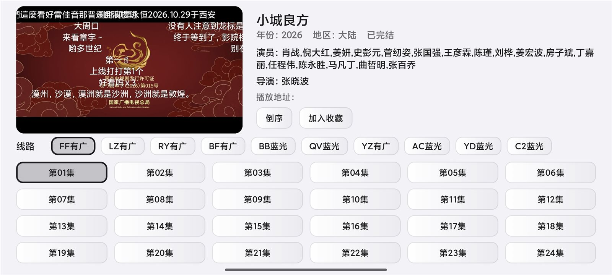 |

### 手机版界面

| 首页 | 搜索 |
|---|---|
|  |  |

| 横版首页 | 横版搜索 |
|---|---|
|  |  |

| 收藏 | 历史 |
|---|---|
| 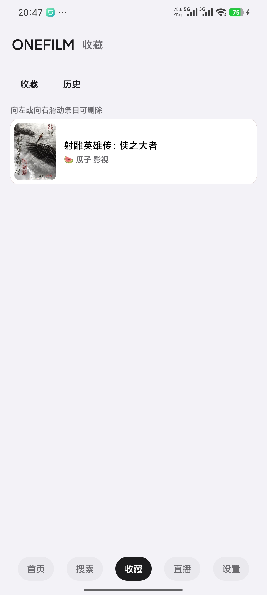 | 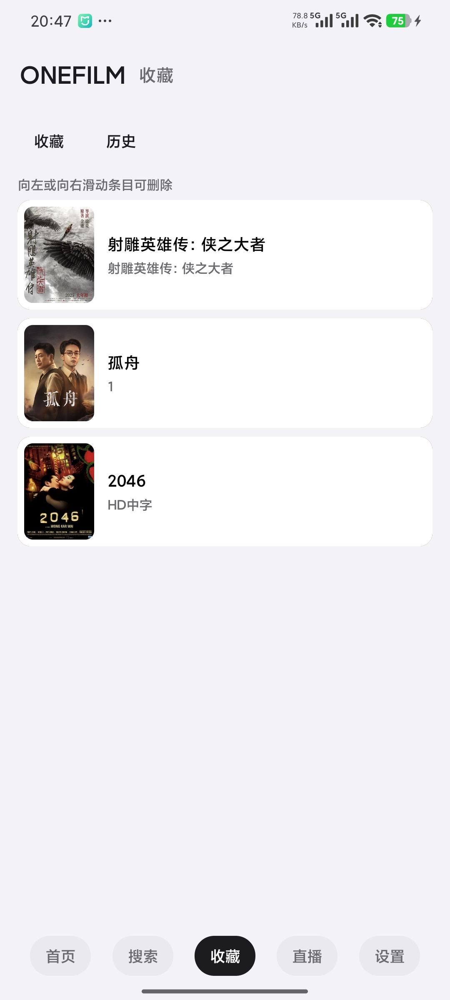 |

| 电影详情 | 分类筛选 |
|---|---|
| 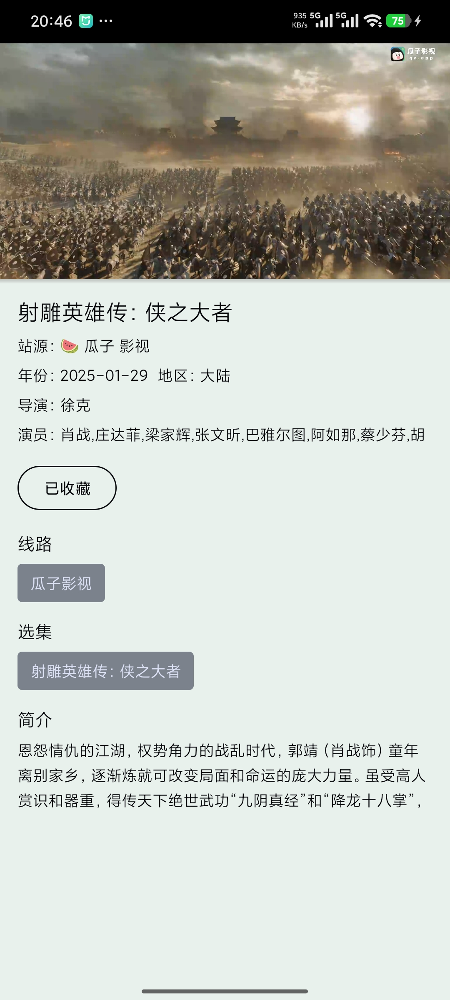 | 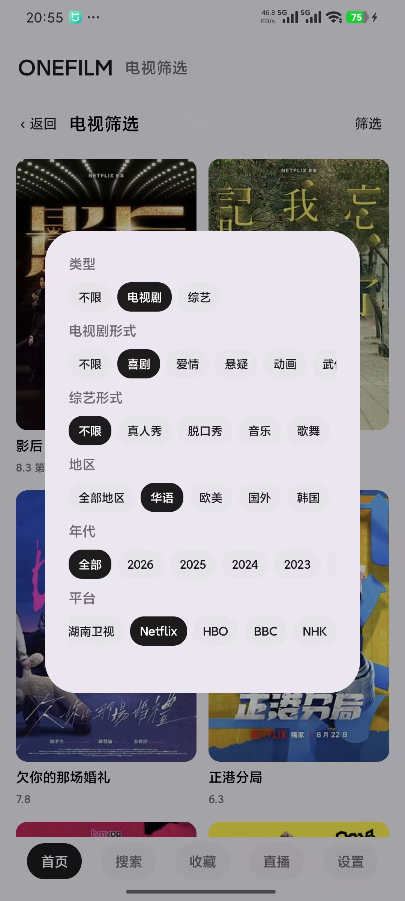 |

| 设置 | 分类 |
|---|---|
| 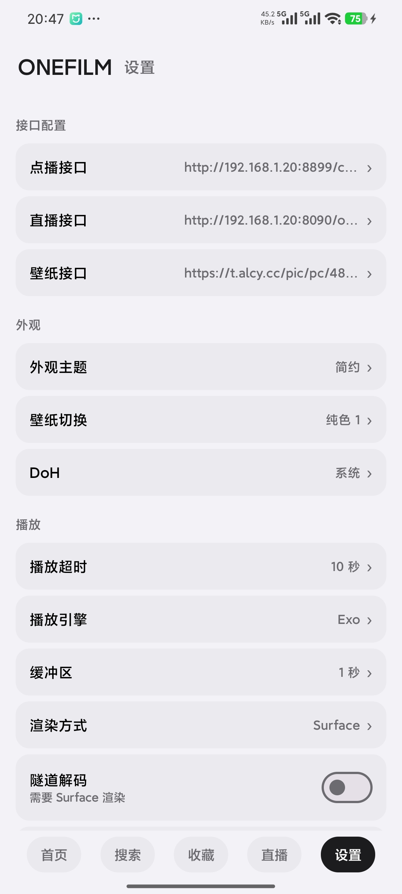 | 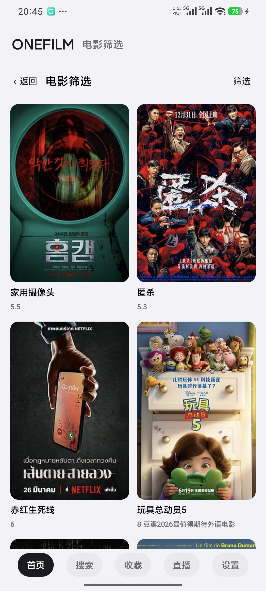 |

> 截图仅用于展示界面和开发测试，影片、海报和接口地址均为演示内容；正式发布版不内置任何影视资源或可用接口。

## 说明

壹影 OneFilm **不提供、不内置、不附带**任何影视内容、直播源或可用点播/直播接口。它只是一个播放器外壳：用户需要自行准备并配置合法的内容接口，并对自己使用的内容来源负责。请勿将本软件用于传播侵权内容或违反当地法律法规的用途。

## 来源与版权

壹影 OneFilm 基于 [FongMi/TV](https://github.com/FongMi/TV) 的 `fongmi` 分支二次开发，继续使用 **GPL-3.0** 许可证。

- 上游项目：[FongMi/TV](https://github.com/FongMi/TV)
- 上游初始提交：`0af3b31a1783b8fa4f0ce12e52ac9fad78ddfb1e`
- 许可证：[LICENSE.md](LICENSE.md)
- 第三方与上游声明：[NOTICE](NOTICE)

感谢上游项目与所有开源贡献者。壹影保留上游来源与版权声明，也保留用户自行配置合法接口的自由。
