# 壹影 OneFilm

> **把电视，变成全家人的私人影院。**

壹影 OneFilm 是一款为 **Android TV、电视盒子和手机大屏** 打造的影视播放器。它把点播、直播、聚合搜索、收藏续播、字幕、弹幕和遥控器操作收进一个清爽的大屏界面里，让你不用在多个 App 之间来回切换。

如果你手里有合法的影视接口、TVBOX 兼容配置或直播源，壹影就是那个负责把内容“好好呈现出来”的播放器：海报墙够大、搜索够快、遥控器够顺手，老人和孩子也能轻松使用。

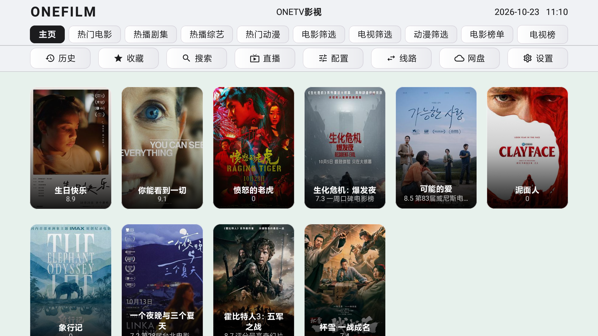

## 一眼看懂

- **一个入口，装下想看的内容**：电影、剧集、综艺、动漫、直播，在同一个电视界面里浏览。
- **TVBOX 兼容接口播放**：支持导入 TVBOX / CatVod 风格的影视与直播接口，接口由用户自行提供。
- **为电视而生**：大字号、大海报、明确的焦点高亮，坐在沙发上用遥控器就能完成所有操作。
- **好看，也好用**：简洁明亮的界面、流畅的卡片动效、没有多余打扰，打开就能看。
- **看得舒服**：支持字幕、音轨、画面比例、倍速、弹幕和多种播放设置。
- **下一次接着看**：收藏、观看历史和续播记录都在，换集、换线路不用重新找。

## 它能做什么

### 客厅里的影视入口

把常用的影视接口集中到一个播放器里。首页是清晰的海报墙，分类、筛选、榜单和搜索都在手边，找片不需要复杂操作。

### 点播与直播，一机搞定

电影、电视剧、综艺、动漫可以按分类浏览；直播频道可以按频道组切换。一个 App，覆盖一家人不同的观看习惯。

### 聚合搜索，少走弯路

输入片名就能同时搜索多个内容源，结果按来源展示，哪条线路能播、哪条更流畅，一眼就能判断。

### 大屏遥控器体验

所有按钮和卡片都为遥控器优化：焦点清楚、移动顺滑、返回不迷路。不是把手机界面简单放大，而是真正适合电视的交互。

### 看得久，也看得舒服

支持字幕样式与位置调整、音轨切换、画面比例、播放速度、弹幕开关等常用功能；全屏播放时控件自动隐藏，确认键暂停，左右键快进退。

### 个性化你的电视

主题、壁纸、接口和播放偏好都可以按自己的习惯调整。简洁、明亮、暗黑，喜欢哪种就用哪种。

## 适合这些场景

- 家里有 Android TV 或电视盒子，希望用一个统一入口看电影、追剧、看直播。
- 已经拥有合法 TVBOX / 影视接口，但想要一个更漂亮、更顺手的播放器。
- 不想研究复杂设置，只想安装、导入接口、然后坐下来看。
- 喜欢大屏海报墙、遥控器焦点和“打开就能继续看”的体验。

## 开始使用

1. 从 [GitHub Releases](https://github.com/Viciy2023/Onefilm/releases) 下载适合设备的 APK：
   - 电视/盒子：`OneFilm-TV-v0.1.7-*.apk`
   - 手机/平板：`OneFilm-Mobile-v0.1.7-*.apk`
2. 安装后打开壹影。
3. 在“配置”或“设置”中导入你自己的合法影视/直播接口。
4. 回到首页，搜索或浏览想看的内容。

> 系统要求：**Android 7.0 及以上**。

## 界面预览

| 首页 | 分类 |
|---|---|
|  | 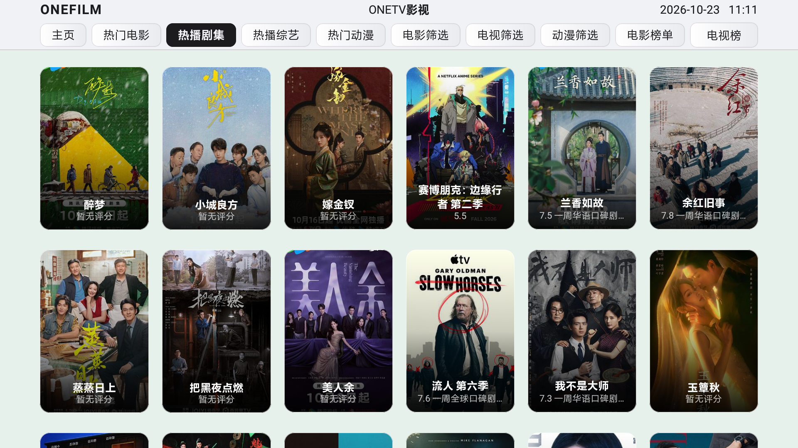 |

| 搜索 | 搜索结果 |
|---|---|
| 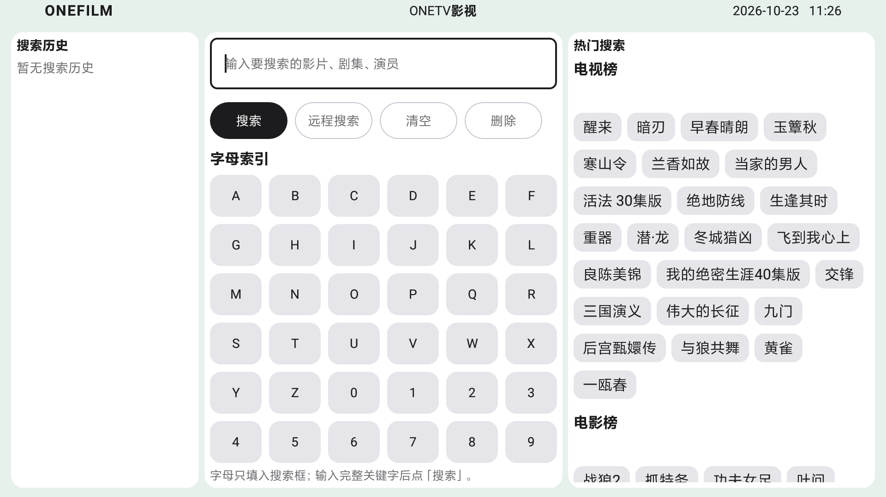 | 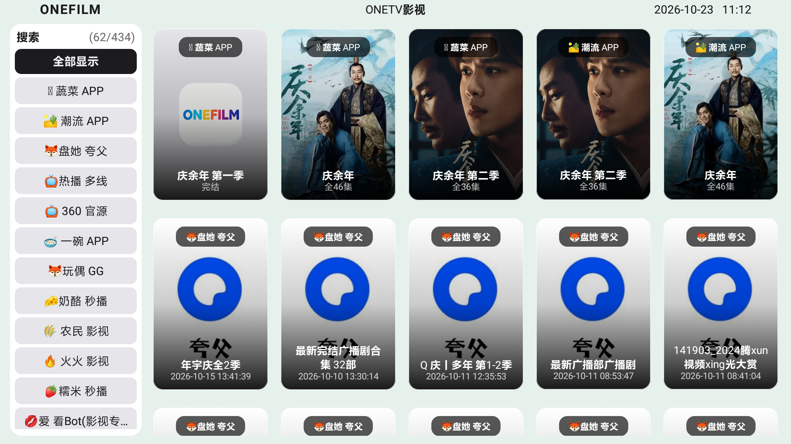 |

| 历史 | 设置 |
|---|---|
| 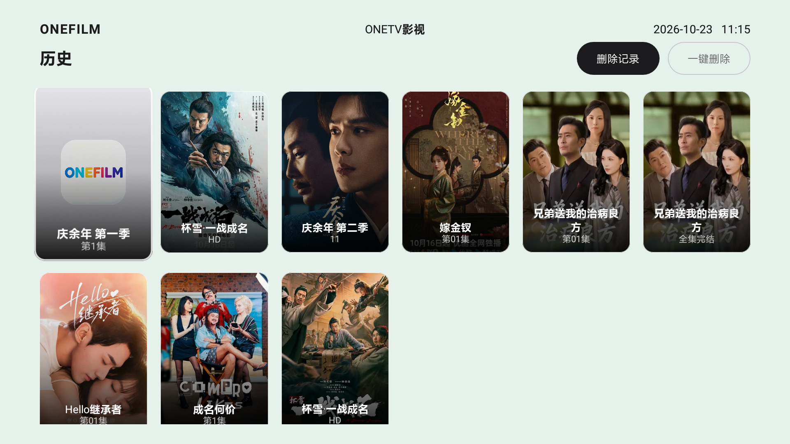 | 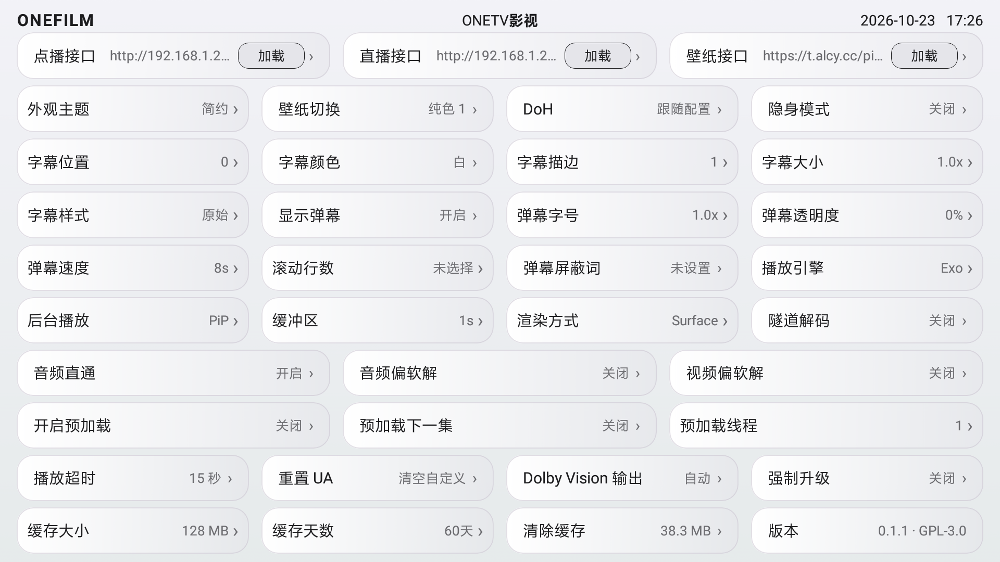 |

| 详情 | 播放 |
|---|---|
| 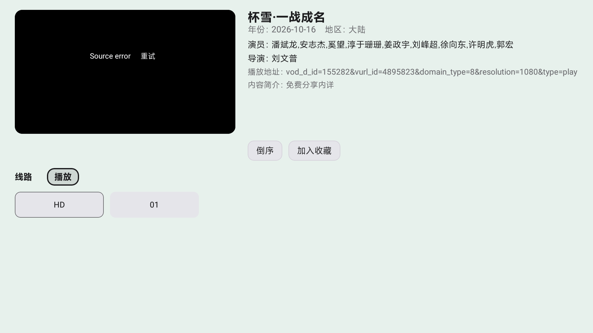 |  |

### 手机版界面

| 首页 | 搜索 |
|---|---|
| 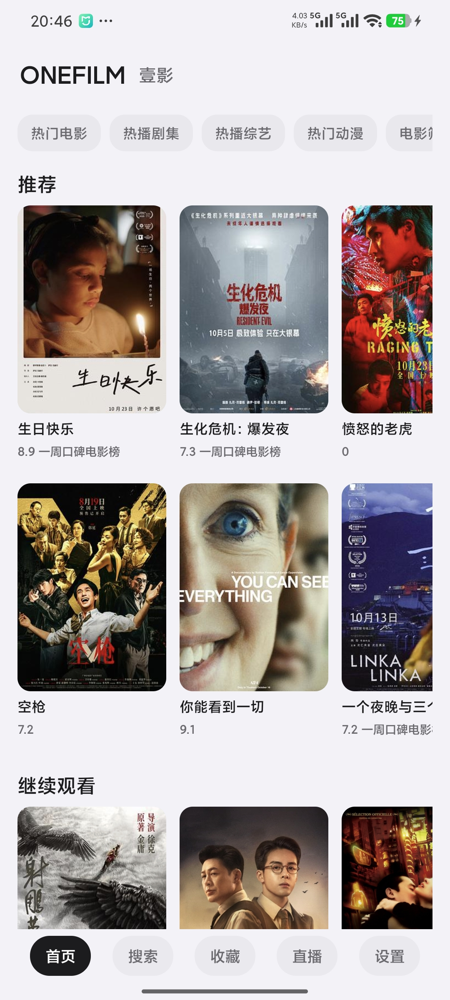 |  |

| 收藏 | 历史 |
|---|---|
| 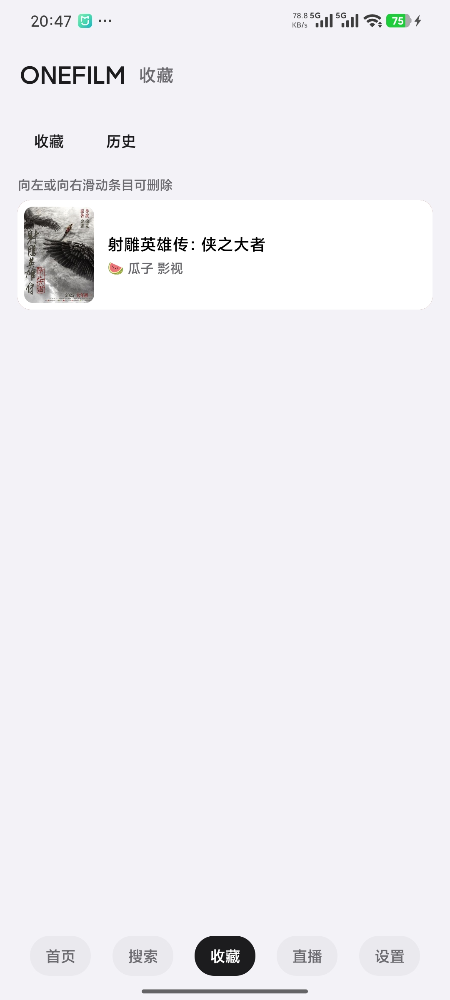 | 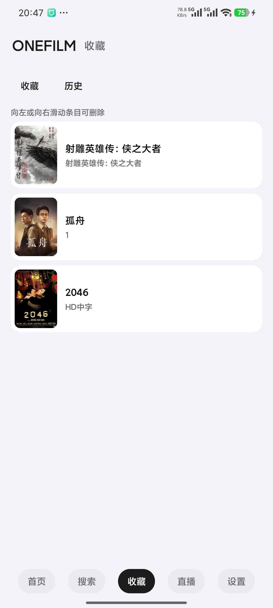 |

| 电影详情 | 分类筛选 |
|---|---|
| 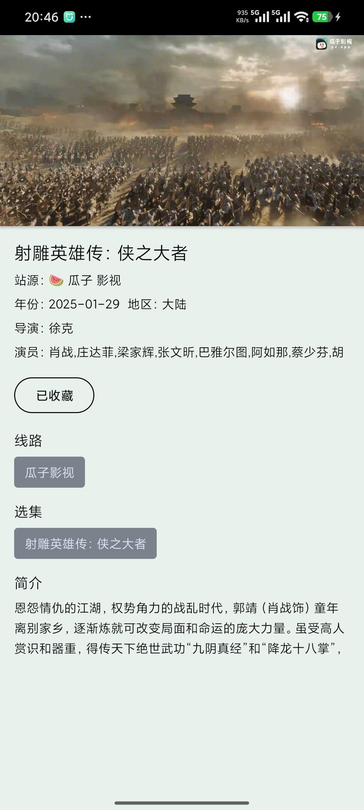 | 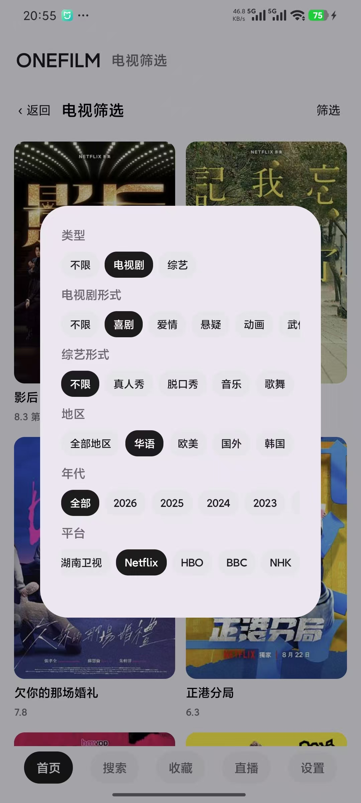 |

| 设置 | 分类 |
|---|---|
| 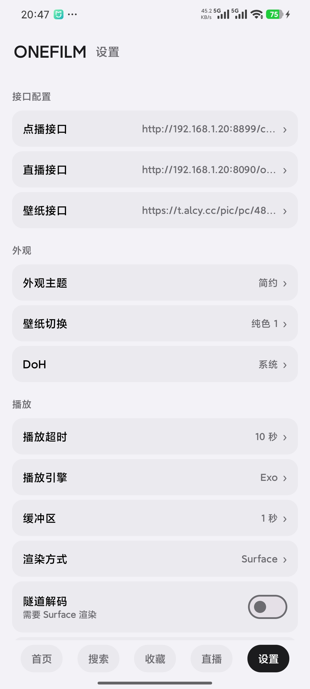 | 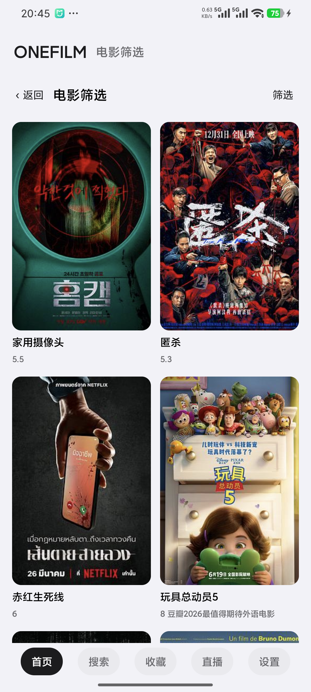 |

> 截图仅用于展示界面和开发测试，影片、海报和接口地址均为演示内容；正式发布版不内置任何影视资源或可用接口。

## 说明

壹影 OneFilm **不提供、不内置、不附带**任何影视内容、直播源或可用点播/直播接口。它只是一个播放器外壳：用户需要自行准备并配置合法的内容接口，并对自己使用的内容来源负责。请勿将本软件用于传播侵权内容或违反当地法律法规的用途。

## 来源与版权

壹影 OneFilm 基于 [FongMi/TV](https://github.com/FongMi/TV) 的 `fongmi` 分支二次开发，继续使用 **GPL-3.0** 许可证。

- 上游项目：[FongMi/TV](https://github.com/FongMi/TV)
- 上游初始提交：`0af3b31a1783b8fa4f0ce12e52ac9fad78ddfb1e`
- 许可证：[LICENSE.md](LICENSE.md)
- 第三方与上游声明：[NOTICE](NOTICE)

感谢上游项目与所有开源贡献者。壹影保留上游来源与版权声明，也保留用户自行配置合法接口的自由。
