[简体中文](README.md) · [繁體中文](README.zh-TW.md) · [English](README.en.md) · [Tiếng Việt](README.vi.md) · **ไทย**

# OneFilm

> **เปลี่ยนทีวีให้เป็นโรงหนังส่วนตัวของทั้งครอบครัว**

OneFilm คือโปรแกรมเล่นวิดีโอที่สร้างมาสำหรับ **Android TV, กล่องทีวี และหน้าจอใหญ่บนมือถือ** รวมวิดีโอตามสั่ง ทีวีสด การค้นหาแบบรวมหลายแหล่ง รายการโปรดและการดูต่อ คำบรรยาย ดานมากุ และการใช้งานด้วยรีโมท ไว้ในอินเทอร์เฟซหน้าจอใหญ่ที่เรียบง่าย ไม่ต้องสลับไปมาระหว่างหลายแอป

ถ้าคุณมีแหล่งหนังที่ถูกกฎหมาย มีการตั้งค่าที่รองรับ TVBOX หรือมีแหล่งช่องสด OneFilm คือโปรแกรมเล่นที่ทำหน้าที่ "นำเสนอเนื้อหาให้ดี" กำแพงโปสเตอร์ใหญ่พอ ค้นหาเร็วพอ รีโมทใช้งานถนัด และผู้สูงอายุกับเด็กก็ใช้ได้ง่าย

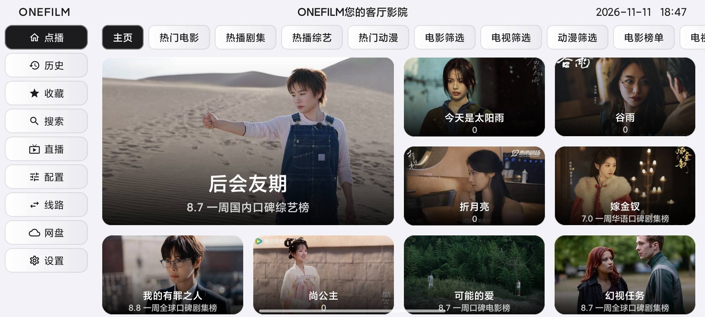

## สรุปสั้น ๆ

- **ทางเดียว รวมทุกอย่างที่อยากดู**: หนัง ซีรีส์ วาไรตี้ อนิเมะ และทีวีสด ดูได้ในอินเทอร์เฟซทีวีเดียวกัน
- **เล่นผ่านแหล่งที่รองรับ TVBOX**: นำเข้าแหล่งหนังและช่องสดแบบ TVBOX / CatVod โดยผู้ใช้เป็นผู้จัดหาแหล่งเอง
- **สร้างมาเพื่อทีวี**: ตัวอักษรใหญ่ โปสเตอร์ใหญ่ ไฮไลต์โฟกัสชัดเจน นั่งโซฟาใช้รีโมทก็ทำได้ทุกอย่าง
- **สวยและใช้ง่าย**: อินเทอร์เฟซสว่าง สะอาด แอนิเมชันการ์ดลื่นไหล ไม่รบกวน เปิดมาก็ดูได้
- **ดูได้สบายตา**: รองรับคำบรรยาย แทร็กเสียง อัตราส่วนภาพ ความเร็วในการเล่น ดานมากุ และการตั้งค่าการเล่นอื่น ๆ
- **ดูต่อในครั้งหน้า**: รายการโปรด ประวัติการดู และตำแหน่งดูต่อถูกเก็บไว้ เปลี่ยนตอนหรือเปลี่ยนแหล่งก็ไม่ต้องหาใหม่
- **ห้าภาษา สลับได้ในแตะเดียว**: 简体中文, 繁體中文, English, Tiếng Việt, ไทย สลับได้ในหน้าตั้งค่า

## ทำอะไรได้บ้าง

### ประตูสู่หนังในห้องนั่งเล่น

รวมแหล่งหนังที่ใช้บ่อยไว้ในโปรแกรมเล่นเดียว หน้าแรกเป็นกำแพงโปสเตอร์ที่ชัดเจน หมวดหมู่ ตัวกรอง อันดับ และการค้นหา อยู่ใกล้มือ หาหนังไม่ต้องทำอะไรซับซ้อน

### ดูตามสั่งและทีวีสด จบในเครื่องเดียว

หนัง ซีรีส์ วาไรตี้ อนิเมะ ดูตามหมวดหมู่ได้ ส่วนช่องสดสลับตามกลุ่มช่องได้ แอปเดียวครอบคลุมพฤติกรรมการดูที่ต่างกันของทั้งครอบครัว

### ค้นหาแบบรวม ลดการเสียเวลา

พิมพ์ชื่อเรื่องก็ค้นหาหลายแหล่งพร้อมกันได้ ผลลัพธ์แสดงตามแหล่ง แหล่งไหนเล่นได้ แหล่งไหนลื่นกว่า ดูแวบเดียวก็รู้

### ประสบการณ์รีโมทบนหน้าจอใหญ่

ทุกปุ่มและการ์ดปรับมาเพื่อรีโมท โฟกัสชัด การเลื่อนลื่น กดย้อนกลับไม่หลงทาง ไม่ใช่การขยายอินเทอร์เฟซมือถือให้ใหญ่ขึ้น แต่เป็นการโต้ตอบที่ออกแบบมาเพื่อทีวีจริง ๆ

### ดูนานก็สบาย

รองรับการปรับรูปแบบและตำแหน่งคำบรรยาย สลับแทร็กเสียง อัตราส่วนภาพ ความเร็วในการเล่น เปิดปิดดานมากุ และฟังก์ชันที่ใช้บ่อยอื่น ๆ ขณะเล่นเต็มจอ ปุ่มควบคุมจะซ่อนอัตโนมัติ ปุ่มยืนยันหยุดชั่วคราว ปุ่มซ้ายขวากรอเร็วและย้อนกลับ

### ปรับทีวีให้เป็นของคุณ

ธีม วอลเปเปอร์ แหล่ง และการตั้งค่าการเล่น ปรับได้ตามความเคยชินของตัวเอง จะเรียบง่าย สว่าง หรือมืด ชอบแบบไหนใช้แบบนั้น

### ห้าภาษาอินเทอร์เฟซ

เมนู ตั้งค่า ปุ่มควบคุมโปรแกรมเล่น พื้นที่เก็บข้อมูลบนเครือข่าย และข้อความแจ้งเตือน รองรับ **简体中文, 繁體中文, English, Tiếng Việt, ไทย** แล้ว สลับใน "ตั้งค่า → ภาษา" แล้วมีผลทันที ทั้ง TV และมือถือใช้ข้อความชุดเดียวกัน การเปลี่ยนภาษาไม่กระทบการตั้งค่าแหล่ง รายการโปรด และประวัติการดู

## เหมาะกับสถานการณ์เหล่านี้

- บ้านมี Android TV หรือกล่องทีวี อยากมีทางเดียวสำหรับดูหนัง ดูซีรีส์ และดูทีวีสด
- มีแหล่ง TVBOX / แหล่งหนังที่ถูกกฎหมายอยู่แล้ว แต่อยากได้โปรแกรมเล่นที่สวยและใช้ง่ายกว่า
- ไม่อยากศึกษาการตั้งค่าซับซ้อน อยากแค่ติดตั้ง นำเข้าแหล่ง แล้วนั่งดู
- ชอบกำแพงโปสเตอร์ใหญ่ โฟกัสด้วยรีโมท และประสบการณ์ "เปิดมาก็ดูต่อได้"

## เริ่มใช้งาน

1. ดาวน์โหลด APK เวอร์ชันล่าสุดจาก [GitHub Releases](https://github.com/Viciy2023/Onefilm/releases/latest):
   - ทีวี/กล่องทีวี: `OneFilm-TV-*.apk`
   - มือถือ/แท็บเล็ต: `OneFilm-Mobile-*.apk`
2. เปิด OneFilm หลังติดตั้ง
3. นำเข้าแหล่งหนัง/ช่องสดที่ถูกกฎหมายของคุณเองใน "การกำหนดค่า" หรือ "ตั้งค่า"
4. กลับไปหน้าแรก ค้นหาหรือเรียกดูเนื้อหาที่อยากดู

> ความต้องการของระบบ: **Android 7.0 ขึ้นไป**

## ตัวอย่างอินเทอร์เฟซ

| หน้าแรก | หมวดหมู่ |
|---|---|
|  | 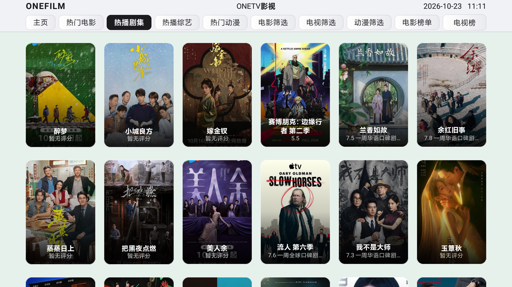 |

| ค้นหา | ผลการค้นหา |
|---|---|
| 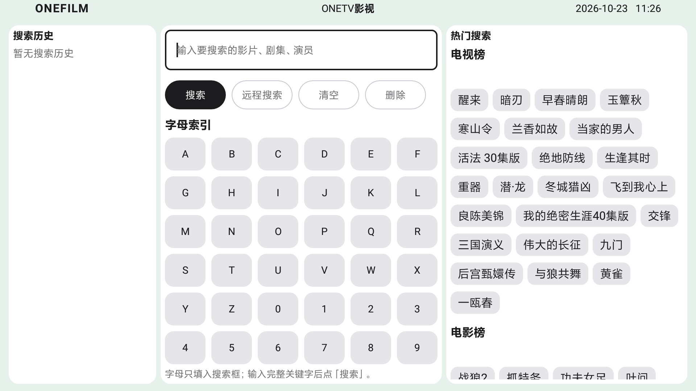 | 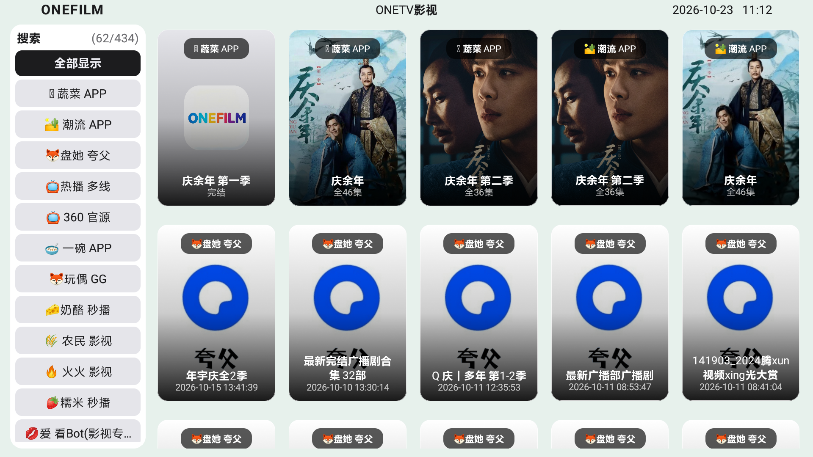 |

| ประวัติ | ตั้งค่า |
|---|---|
| 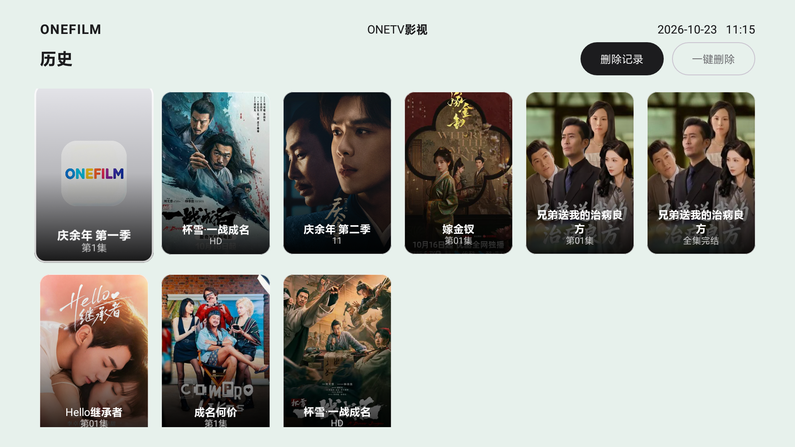 | 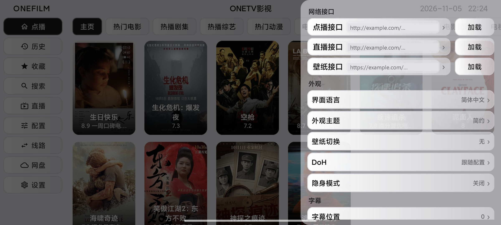 |

| รายละเอียด | เล่น |
|---|---|
| 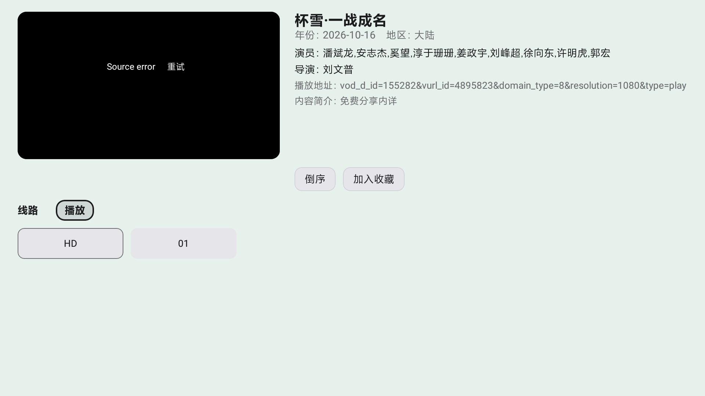 |  |

### อินเทอร์เฟซเวอร์ชันมือถือ

| หน้าแรก | ค้นหา |
|---|---|
| 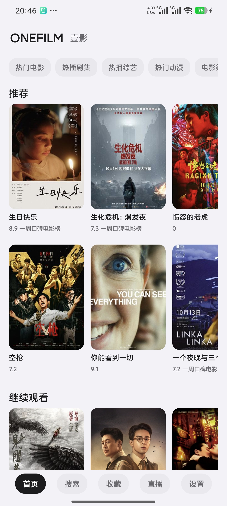 | 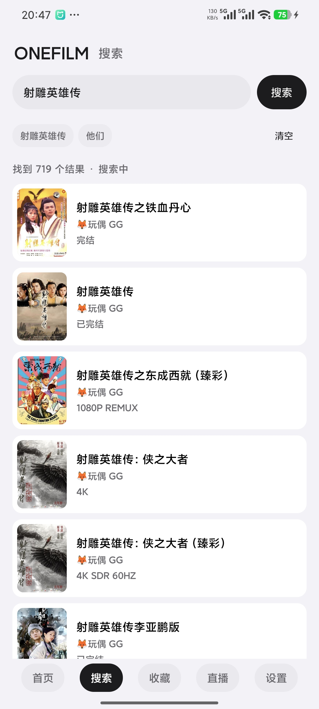 |

| รายการโปรด | ประวัติ |
|---|---|
| 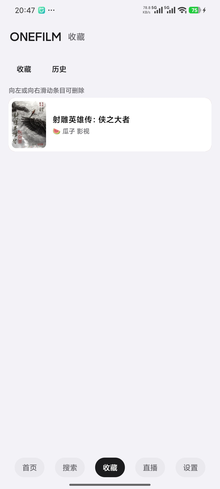 | 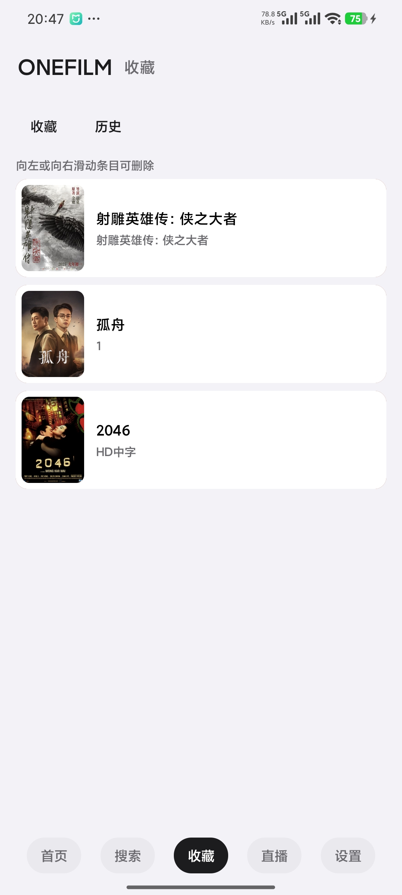 |

| รายละเอียดหนัง | ตัวกรองหมวดหมู่ |
|---|---|
| 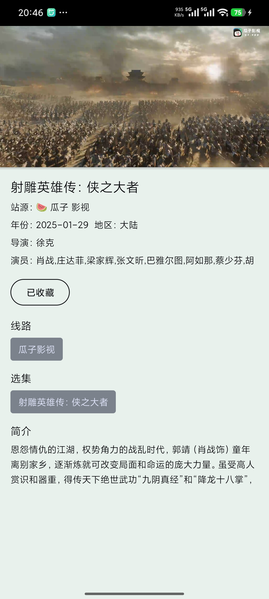 | 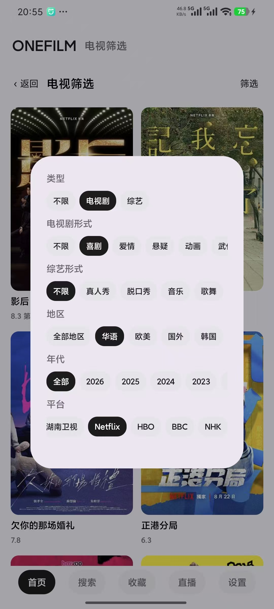 |

| ตั้งค่า | หมวดหมู่ |
|---|---|
| 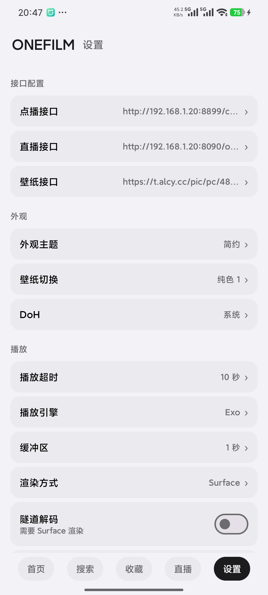 | 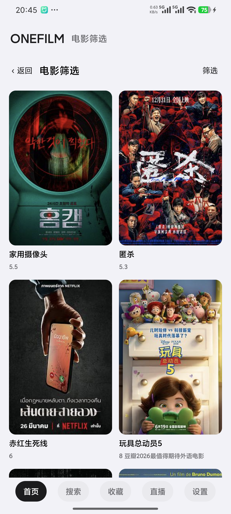 |

> ภาพหน้าจอใช้เพื่อแสดงอินเทอร์เฟซและทดสอบการพัฒนาเท่านั้น หนัง โปสเตอร์ และที่อยู่ของแหล่งเป็นเนื้อหาสาธิต เวอร์ชันเผยแพร่อย่างเป็นทางการไม่มีทรัพยากรหนังหรือแหล่งที่ใช้งานได้ฝังอยู่

## หมายเหตุ

OneFilm **ไม่มีให้บริการ ไม่ได้ฝังไว้ และไม่ได้แนบมา** กับเนื้อหาหนัง แหล่งช่องสด หรือแหล่งดูตามสั่ง/ช่องสดที่ใช้งานได้ใด ๆ เป็นเพียงเปลือกของโปรแกรมเล่น ผู้ใช้ต้องเตรียมและตั้งค่าแหล่งเนื้อหาที่ถูกกฎหมายด้วยตนเอง และรับผิดชอบต่อแหล่งที่ใช้งาน โปรดอย่าใช้ซอฟต์แวร์นี้เผยแพร่เนื้อหาที่ละเมิดลิขสิทธิ์หรือเพื่อวัตถุประสงค์ที่ผิดกฎหมายในท้องถิ่น

## ที่มาและลิขสิทธิ์

OneFilm พัฒนาต่อจากสาขา `fongmi` ของ [FongMi/TV](https://github.com/FongMi/TV) และยังคงใช้สัญญาอนุญาต **GPL-3.0**

- โปรเจกต์ต้นทาง: [FongMi/TV](https://github.com/FongMi/TV)
- คอมมิตเริ่มต้นของต้นทาง: `0af3b31a1783b8fa4f0ce12e52ac9fad78ddfb1e`
- สัญญาอนุญาต: [LICENSE.md](LICENSE.md)
- ประกาศของบุคคลที่สามและต้นทาง: [NOTICE](NOTICE)

ขอบคุณโปรเจกต์ต้นทางและผู้ร่วมพัฒนาโอเพนซอร์สทุกคน OneFilm เก็บที่มาและประกาศลิขสิทธิ์ของต้นทางไว้ รวมทั้งเก็บเสรีภาพของผู้ใช้ในการตั้งค่าแหล่งที่ถูกกฎหมายด้วยตนเอง
