[简体中文](README.md) · [繁體中文](README.zh-TW.md) · [English](README.en.md) · **Tiếng Việt** · [ไทย](README.th.md)

# OneFilm

> **Biến chiếc TV thành rạp phim riêng của cả gia đình.**

OneFilm là trình phát video dành cho **Android TV, TV box và màn hình lớn trên điện thoại**. Ứng dụng gom video theo yêu cầu, truyền hình trực tiếp, tìm kiếm tổng hợp, yêu thích và xem tiếp, phụ đề, danmaku cùng thao tác bằng điều khiển vào một giao diện màn hình lớn gọn gàng, để bạn không phải chuyển qua lại giữa nhiều ứng dụng.

Nếu bạn đã có nguồn phim hợp pháp, cấu hình tương thích TVBOX hoặc nguồn kênh trực tiếp, OneFilm chính là trình phát lo phần "trình bày nội dung cho tử tế": tường poster đủ lớn, tìm kiếm đủ nhanh, điều khiển đủ thuận tay, người lớn tuổi và trẻ nhỏ cũng dùng dễ dàng.

🌐 **Trang chủ dự án**: <https://film.onetv.de5.net/>

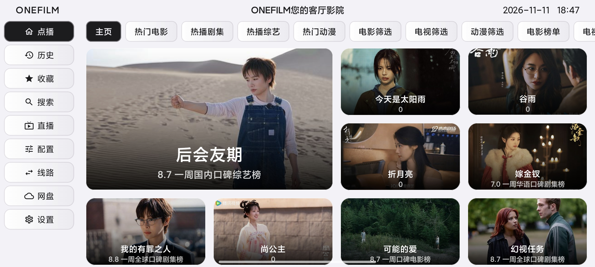

- **Dịch phụ đề AI thời gian thực**: nhận dạng giọng nói ngoại ngữ ngay trên thiết bị và dịch thành phụ đề tiếng Trung, xem phim Nhật, phim Âu Mỹ cũng có phụ đề song ngữ đồng bộ.
## Nhìn qua là hiểu

- **Một nơi cho mọi thứ bạn muốn xem**: phim lẻ, phim bộ, show giải trí, anime và truyền hình trực tiếp, tất cả trong cùng một giao diện TV.
- **Phát nội dung tương thích TVBOX**: hỗ trợ nhập nguồn phim và nguồn trực tiếp kiểu TVBOX / CatVod; nguồn do người dùng tự cung cấp.
- **Sinh ra cho TV**: chữ lớn, poster lớn, điểm sáng tiêu điểm rõ ràng, ngồi trên ghế sofa dùng điều khiển là làm được mọi thứ.
- **Đẹp và dễ dùng**: giao diện sáng, gọn, hiệu ứng thẻ mượt, không làm phiền; mở lên là xem.
- **Xem thoải mái**: hỗ trợ phụ đề, âm thanh, tỉ lệ khung hình, tốc độ phát, danmaku và nhiều tuỳ chọn phát khác.
- **Lọc quảng cáo video**: tự động nhận diện và bỏ qua quảng cáo m3u8; nguồn chưa có quy tắc sẽ dựa vào đặc điểm URL và tính liên tục của dòng thời gian PTS.
- **Bình luận bay**: tương thích máy chủ bình luận bay thông dụng hoặc API tùy chỉnh, tự động khớp tên phim và tập; hỗ trợ nút công cộng hoặc tự dựng.
- **Lần sau xem tiếp**: yêu thích, lịch sử xem và vị trí xem tiếp đều được lưu, đổi tập hay đổi nguồn không cần tìm lại.
- **Năm ngôn ngữ, chuyển trong một chạm**: 简体中文, 繁體中文, English, Tiếng Việt, ไทย, chuyển ngay trong Cài đặt.
- **Hai kiểu áp phích**: chuyển giữa tường áp phích dọc 2:3 và bố cục ngang 16:9 trong "Cài đặt → Giao diện → Kiểu áp phích"; áp dụng cho Trang chủ, Danh mục, Tìm kiếm, Yêu thích và Lịch sử.

## Ứng dụng làm được gì

### Dịch phụ đề AI thời gian thực

Khi phát phim hoặc series ngoại ngữ, OneFilm nhận dạng giọng nói ngay trên thiết bị và dịch thành phụ đề tiếng Trung đồng bộ với lời thoại — phim Nhật, phim Âu Mỹ đều có phụ đề tiếng Trung của chúng ta.

- **Nhận dạng trên thiết bị**: các mô hình Quan Thoại, Quảng Đông, Anh, Nhật, Hàn, Đức, Pháp, Tây Ban Nha, Nga chạy cục bộ; âm thanh không được tải lên.
- **Dịch tùy chọn**: Youdao (không cần cấu hình), MTranServer tự dựng, hoặc LLM tương thích OpenAI; chọn song ngữ hoặc chỉ bản dịch.
- **Tùy chỉnh hiển thị**: vị trí, màu (trắng/đỏ/xanh lá/vàng/ngẫu nhiên), cỡ chữ, viền, in đậm, phông — bảng cài đặt và hộp thoại trong trình phát dùng chung tham số.
- **Tải theo ngôn ngữ**: mỗi ngôn ngữ một gói mô hình; tiếng Quảng Đông/Nhật dùng nhận dạng ngoại tuyến nên chậm hơn mô hình streaming một chút.

**Hiệu năng và lựa chọn mô hình**

- Mỗi ngôn ngữ có hai bộ mô hình: **tiêu chuẩn** (chính xác hơn, hợp với điện thoại, máy tính bảng và box mạnh) và **rút gọn** (nhỏ hơn nhiều, cần ít CPU, hợp với TV 4 nhân / 2GB RAM).
- **Không nên dùng mô hình tiêu chuẩn trên TV yếu.** Thử nghiệm trên TV Amlogic 4 nhân, 2GB RAM với mô hình tiếng Quan Thoại 162MB cho RTF ≈ 2.3 (chỉ bằng một nửa thời gian thực): hàng đợi âm thanh luôn đầy, bắt đầu mất khung, phụ đề chậm hơn mười giây và không khớp hình; khi áp lực bộ nhớ tăng, hệ thống có thể kill ứng dụng.
- Khuyến nghị:
  - Trên TV nên chọn "Tiếng Quan Thoại (rút gọn)" (≈26 MB) hoặc "Tiếng Anh (rút gọn)";
  - Tải mô hình rút gọn trước khi bật nhận dạng trực tiếp;
  - Nếu TV giật hoặc ứng dụng bị kill, hãy chuyển về mô hình rút gọn và đóng ứng dụng nền;
  - Điện thoại/thiết bị mạnh có thể dùng mô hình tiêu chuẩn để có độ chính xác cao hơn;
  - Hiện chỉ tiếng Quan Thoại và tiếng Anh có cả hai bộ; tiếng Đức, Pháp, Tây Ban Nha, Hàn, Nga, Quảng Đông và Nhật chỉ có một bộ (bản tiếng Nhật đã là bản nhỏ nhất chính thức).

### Bình luận bay

Tương thích máy chủ bình luận bay thông dụng, hoặc tự nhập API bình luận bay trong Cài đặt. Tự động khớp tên phim và tập; hỗ trợ nút công cộng và dịch vụ tự dựng.

### Cổng nội dung trong phòng khách

Gom những nguồn phim quen dùng vào một trình phát. Trang chủ là tường poster rõ ràng, phân loại, bộ lọc, bảng xếp hạng và tìm kiếm đều trong tầm tay, tìm phim không cần thao tác phức tạp.

### Xem theo yêu cầu và truyền hình trực tiếp, một ứng dụng lo hết

Phim lẻ, phim bộ, show giải trí, anime có thể duyệt theo phân loại; kênh trực tiếp chuyển theo nhóm kênh. Một ứng dụng đáp ứng những thói quen xem khác nhau của cả gia đình.

### Tìm kiếm tổng hợp, đỡ mất công

Nhập tên phim là tìm được đồng thời ở nhiều nguồn nội dung, kết quả hiển thị theo nguồn; nguồn nào phát được, nguồn nào mượt hơn, nhìn là biết ngay.

### Trải nghiệm điều khiển trên màn hình lớn

Mọi nút và thẻ đều được tối ưu cho điều khiển: tiêu điểm rõ, di chuyển mượt, bấm quay lại không bị lạc. Đây không phải giao diện điện thoại phóng to đơn thuần, mà là cách tương tác thực sự phù hợp với TV.

### Xem lâu vẫn thoải mái

Hỗ trợ chỉnh kiểu và vị trí phụ đề, chuyển âm thanh, tỉ lệ khung hình, tốc độ phát, bật tắt danmaku và các chức năng thường dùng khác; khi phát toàn màn hình, các nút điều khiển tự ẩn, nút xác nhận tạm dừng, phím trái phải tua nhanh và tua lại.

### Cá nhân hoá chiếc TV của bạn

Giao diện, hình nền, nguồn và tuỳ chọn phát đều có thể chỉnh theo thói quen của bạn. Đơn giản, sáng, tối, thích kiểu nào dùng kiểu đó.

### Năm ngôn ngữ giao diện

Menu, cài đặt, điều khiển trình phát, ổ đĩa mạng và thông báo đều đã hỗ trợ **简体中文, 繁體中文, English, Tiếng Việt, ไทย**. Chuyển trong "Cài đặt → Ngôn ngữ" là có hiệu lực ngay, TV và điện thoại dùng chung một bộ nội dung; đổi ngôn ngữ không ảnh hưởng tới cấu hình nguồn, yêu thích và lịch sử xem.

## Phù hợp với những trường hợp này

- Nhà có Android TV hoặc TV box, muốn một nơi thống nhất để xem phim, xem bộ, xem trực tiếp.
- Đã có nguồn TVBOX / nguồn phim hợp pháp nhưng muốn một trình phát đẹp hơn, thuận tiện hơn.
- Không muốn tìm hiểu cài đặt phức tạp, chỉ muốn cài, nhập nguồn rồi ngồi xem.
- Thích tường poster lớn, tiêu điểm bằng điều khiển và kiểu "mở lên là xem tiếp".

## Bắt đầu sử dụng

1. Tải xuống APK mới nhất từ [GitHub Releases](https://github.com/Viciy2023/Onefilm/releases/latest):
   - TV/TV box: `OneFilm-TV-*.apk`
   - Điện thoại/máy tính bảng: `OneFilm-Mobile-*.apk`
   - TV/máy chiếu đời cũ (Android 5.0+): `OneFilm-LITE-*.apk`
2. Mở OneFilm sau khi cài đặt.
3. Nhập nguồn phim/trực tiếp hợp pháp của bạn trong "Cấu hình" hoặc "Cài đặt".
4. Quay lại trang chủ, tìm kiếm hoặc duyệt nội dung muốn xem.

> Yêu cầu hệ thống: bản TV/điện thoại cần **Android 7.0 trở lên**; **bản LITE cần Android 5.0 trở lên** (API 21).
>
> Về bản LITE: dùng chung giao diện và nghiệp vụ với bản TV, có tên gói riêng nên cài song song được. Để tương thích Android 5.x, bản LITE không gồm plugin Python, tải xuống Thunder, lõi truyền màn hình (TVBus) và phần giải mã AV1/FFmpeg/IAMF; trang chủ, tìm kiếm, chi tiết, phát lại, yêu thích/lịch sử và truyền hình trực tiếp vẫn giữ nguyên. Bản LITE chỉ phát hành một gói `armeabi-v7a` (khoảng 18 MB).

## Hiệu năng và bộ nhớ

Tìm kiếm tổng hợp tạo ra nhiều engine script tạm thời; cách thu hồi bộ nhớ này quyết định thiết bị yếu có chạy ổn định hay không. Từ 0.1.22, việc thu hồi engine dùng: giải phóng từng site, bảo vệ site đang chạy, dọn dẹp dự phòng sau mỗi 10 site và giải phóng cưỡng bức cho site quá thời gian.

Đo trên cùng một thiết bị với 313 site và 5 lần tìm kiếm đầy đủ liên tiếp:

| Tình huống | Trước | Sau |
|---|---:|---:|
| Native cao nhất khi tìm kiếm | 765 MB | 281 MB |
| Tổng bộ nhớ (PSS) cao nhất khi tìm kiếm | 1.06 GB | 537 MB |
| Thời gian duy trì mức cao | 30–40 giây | 4–6 giây |
| Native khi phát sau tìm kiếm | 743 MB | 116 MB |
| Tổng bộ nhớ khi phát sau tìm kiếm | 1.01 GB | 366 MB |
| Tổng bộ nhớ sau khi thoát trình phát | 814 MB | 354 MB |
| Native 60 giây sau tìm kiếm | 177 MB | 115 MB |

Ghi chú:

- Trình phát rất nhẹ: phát ngay sau khi khởi động lạnh chỉ tăng khoảng 20 MB; phần lớn áp lực đến từ engine tạm thời khi tìm kiếm.
- Bộ nhớ được giải phóng sớm hơn, nên **TV và box 2 GB / 3 GB ít bị hệ thống thu hồi hơn khi tìm kiếm hoặc chuyển tập**, giảm giật và giảm việc bị thoát giữa chừng.
- Dữ liệu từ một thiết bị 11.4 GB, giao diện và từ khóa cố định; kết quả thay đổi theo số site, loại giao diện và mạng.

### Đo trên TV 2 GB (Android 9)

Lặp lại đúng 5 lần tìm kiếm và phát với cùng 313 site trên TV Xiaomi 2 GB chạy Android 9:

| Tình huống | PSS ứng dụng | Native | Bộ nhớ hệ thống còn trống |
|---|---:|---:|---:|
| Trang chủ nhàn rỗi | 104 MB | 20 MB | 800 MB |
| Cao nhất khi 5 lần tìm kiếm | 303 MB | 156 MB | 677 MB |
| 60 giây sau tìm kiếm | 197 MB | 53 MB | 778 MB |
| Phát sau tìm kiếm | 209 MB | 52 MB | 650–758 MB |
| Chuyển xuống nền | 192 MB | 53 MB | 700 MB |

Tiến trình không bị hệ thống kill, bộ nhớ trống thấp nhất khoảng 677 MB, cho thấy thiết bị 2 GB vẫn còn đủ dư.

## Xem trước giao diện

| Trang chủ | Phân loại |
|---|---|
|  | 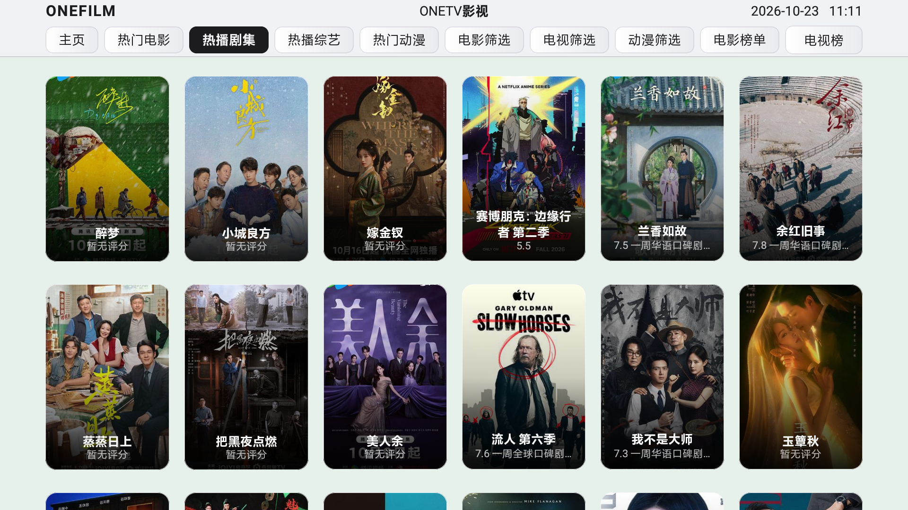 |

| Trang chủ ngang | Tìm kiếm ngang |
|---|---|
| 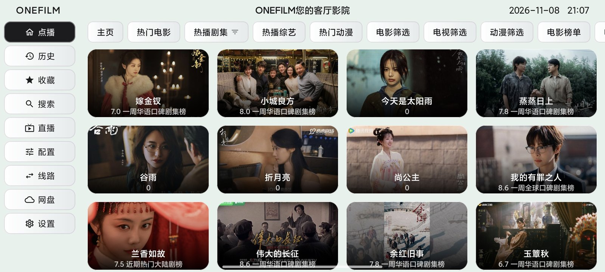 | 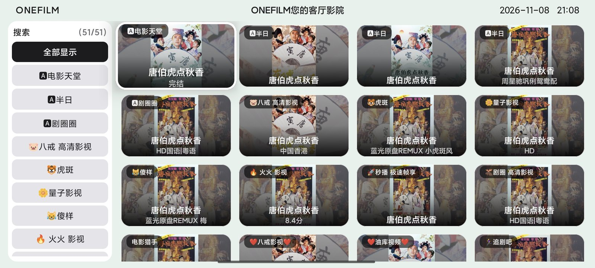 |

| Tìm kiếm | Kết quả tìm kiếm |
|---|---|
| 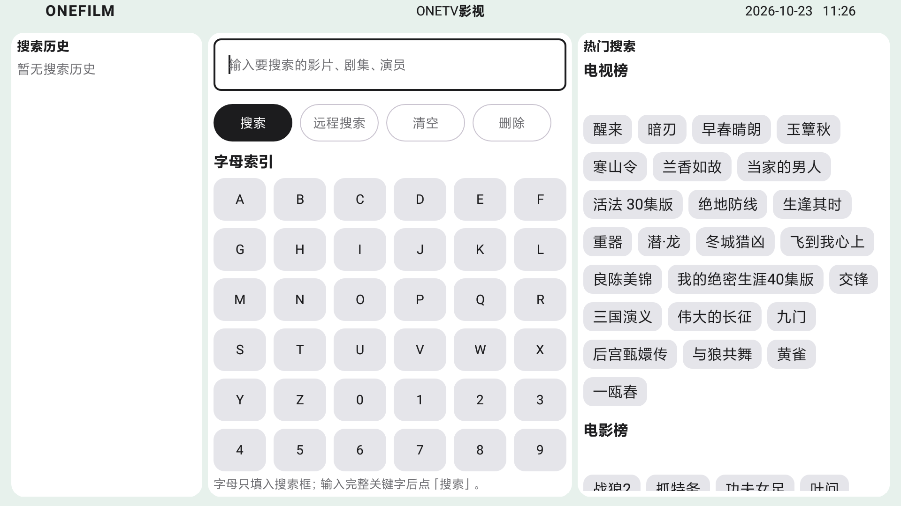 | 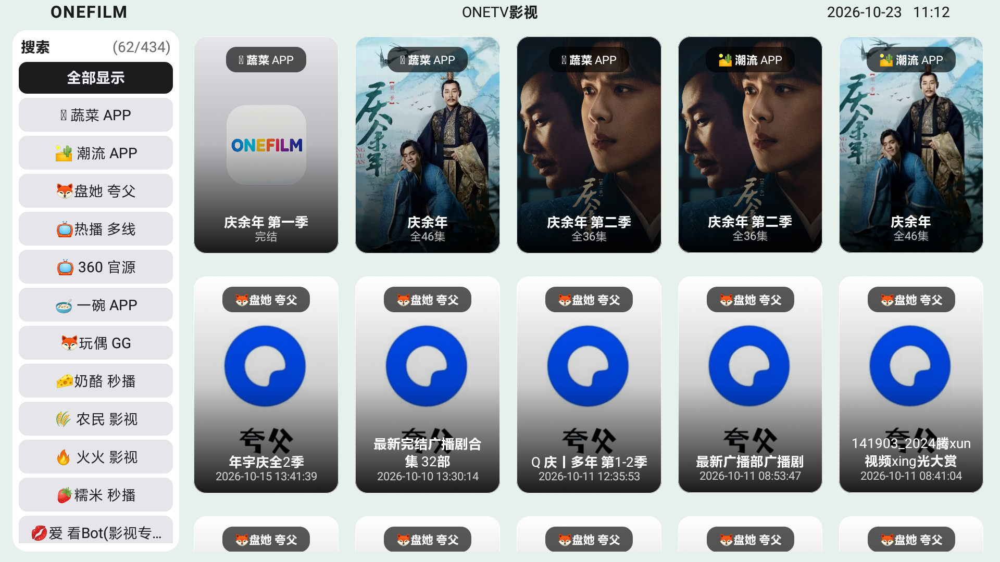 |

| Lịch sử | Cài đặt |
|---|---|
| 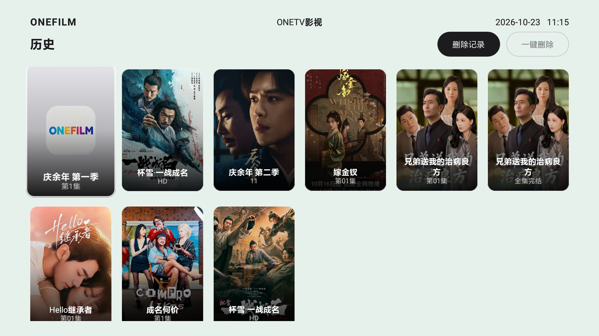 | 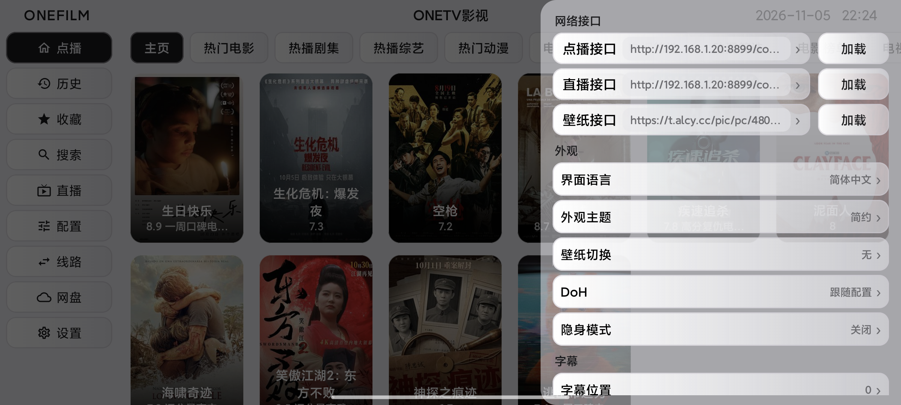 |

| Chi tiết | Phát |
|---|---|
| 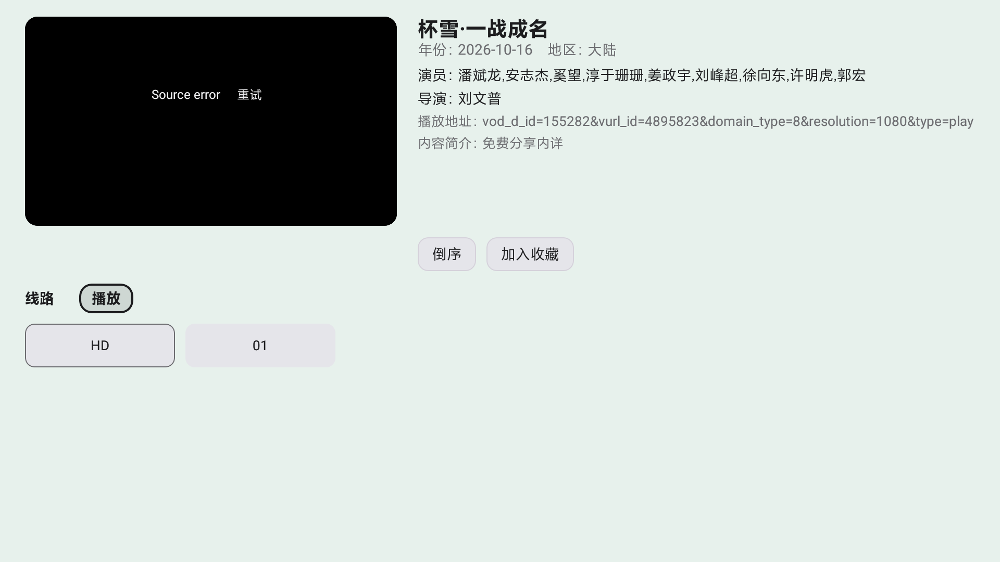 |  |

| Bình luận bay toàn màn hình | Bình luận bay cửa sổ nhỏ |
|---|---|
| 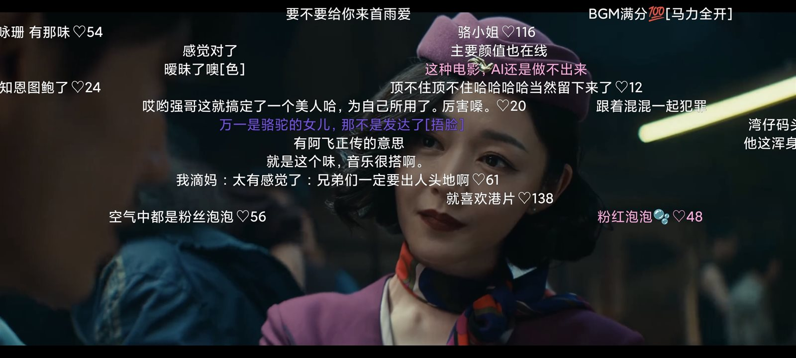 | 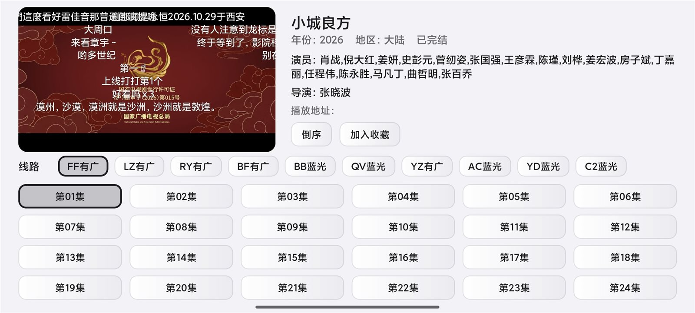 |

### Giao diện trên điện thoại

| Trang chủ | Tìm kiếm |
|---|---|
| 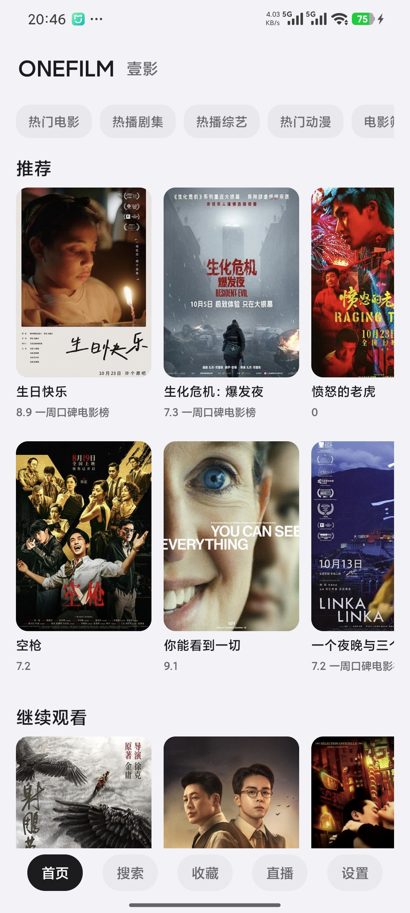 | 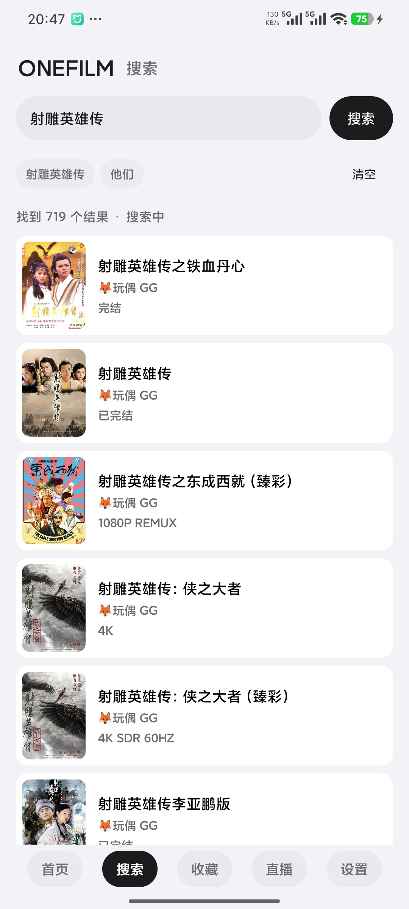 |

| Trang chủ ngang | Tìm kiếm ngang |
|---|---|
| 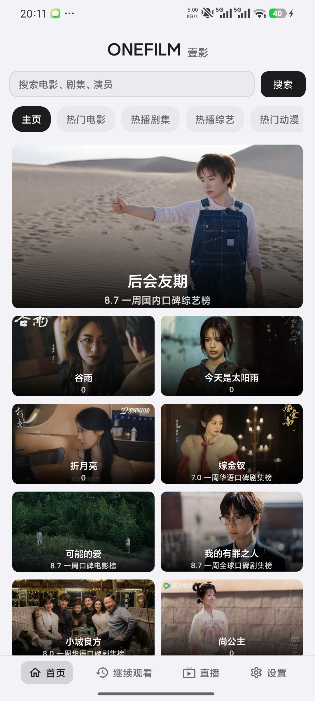 | 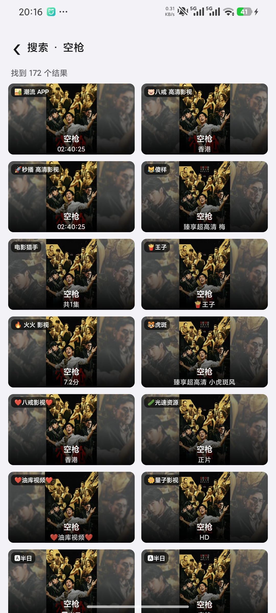 |

| Yêu thích | Lịch sử |
|---|---|
| 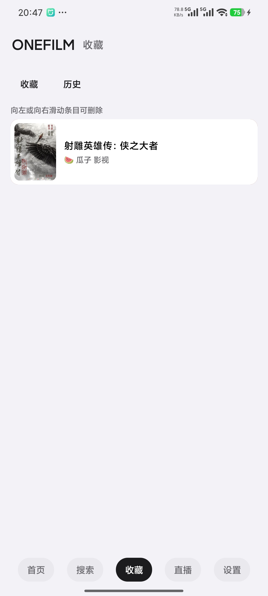 | 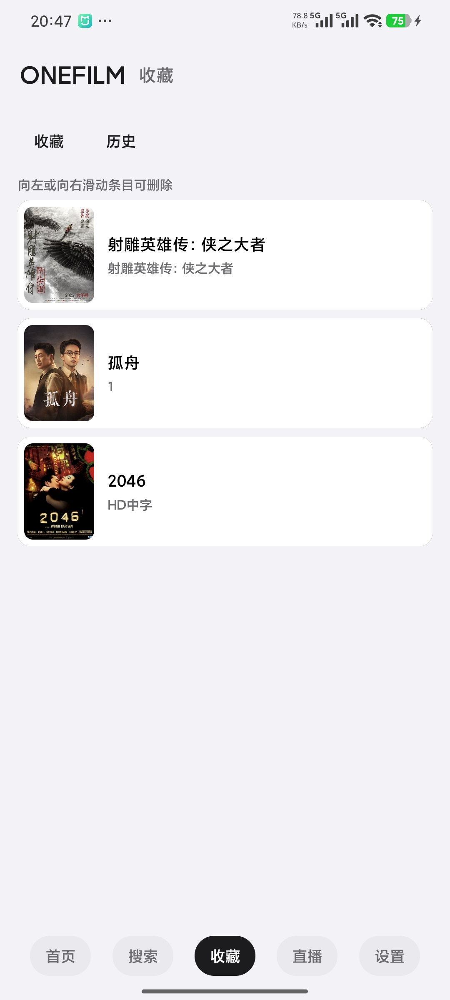 |

| Chi tiết phim | Lọc theo phân loại |
|---|---|
| 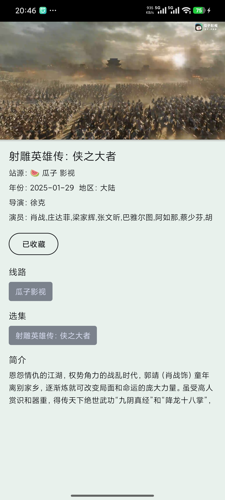 | 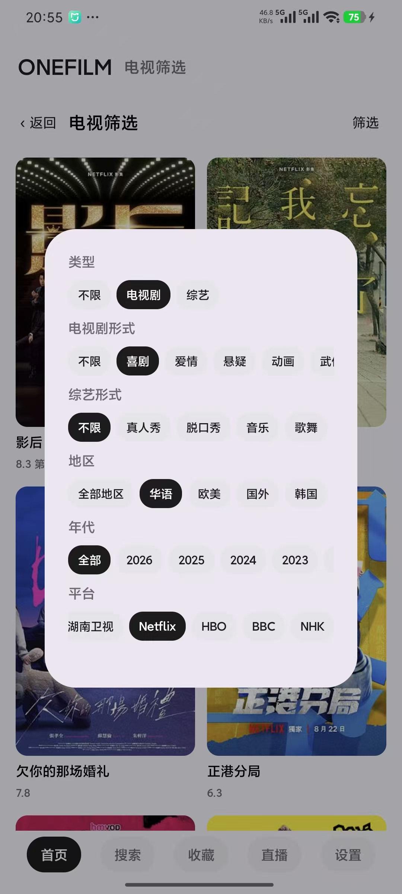 |

| Cài đặt | Phân loại |
|---|---|
| 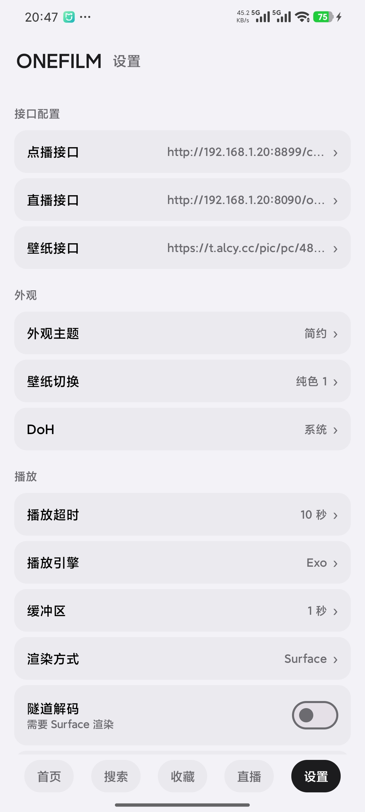 | 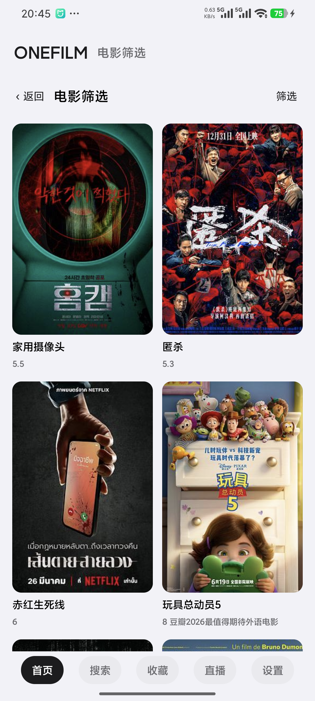 |

> Ảnh chụp chỉ dùng để minh hoạ giao diện và kiểm thử trong quá trình phát triển; phim, poster và địa chỉ nguồn đều là nội dung demo; bản phát hành chính thức không tích hợp sẵn bất kỳ tài nguyên phim hay nguồn khả dụng nào.

## Lưu ý

OneFilm **không cung cấp, không tích hợp sẵn và không kèm theo** bất kỳ nội dung phim, nguồn trực tiếp hay nguồn xem theo yêu cầu/trực tiếp khả dụng nào. Đây chỉ là lớp vỏ của trình phát: người dùng cần tự chuẩn bị và cấu hình nguồn nội dung hợp pháp, đồng thời tự chịu trách nhiệm về nguồn mình sử dụng. Không dùng phần mềm này để phát tán nội dung xâm phạm bản quyền hoặc cho mục đích vi phạm pháp luật địa phương.

## Nguồn gốc và bản quyền

OneFilm được phát triển lại dựa trên nhánh `fongmi` của [FongMi/TV](https://github.com/FongMi/TV), tiếp tục sử dụng giấy phép **GPL-3.0**.

- Dự án gốc: [FongMi/TV](https://github.com/FongMi/TV)
- Commit khởi đầu của dự án gốc: `0af3b31a1783b8fa4f0ce12e52ac9fad78ddfb1e`
- Giấy phép: [LICENSE.md](LICENSE.md)
- Thông báo của bên thứ ba và dự án gốc: [NOTICE](NOTICE)

Cảm ơn dự án gốc và toàn bộ những người đóng góp mã nguồn mở. OneFilm giữ lại nguồn gốc và thông báo bản quyền của dự án gốc, đồng thời giữ quyền tự cấu hình nguồn hợp pháp của người dùng.
