[简体中文](README.md) · [繁體中文](README.zh-TW.md) · [English](README.en.md) · **Tiếng Việt** · [ไทย](README.th.md)

# OneFilm

> **Biến chiếc TV thành rạp phim riêng của cả gia đình.**

OneFilm là trình phát video dành cho **Android TV, TV box và màn hình lớn trên điện thoại**. Ứng dụng gom video theo yêu cầu, truyền hình trực tiếp, tìm kiếm tổng hợp, yêu thích và xem tiếp, phụ đề, danmaku cùng thao tác bằng điều khiển vào một giao diện màn hình lớn gọn gàng, để bạn không phải chuyển qua lại giữa nhiều ứng dụng.

Nếu bạn đã có nguồn phim hợp pháp, cấu hình tương thích TVBOX hoặc nguồn kênh trực tiếp, OneFilm chính là trình phát lo phần "trình bày nội dung cho tử tế": tường poster đủ lớn, tìm kiếm đủ nhanh, điều khiển đủ thuận tay, người lớn tuổi và trẻ nhỏ cũng dùng dễ dàng.

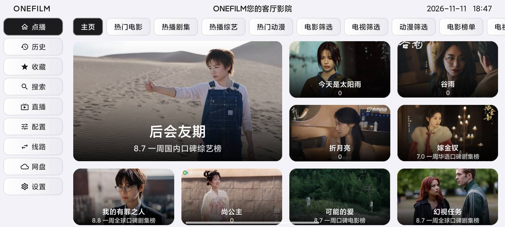

## Nhìn qua là hiểu

- **Một nơi cho mọi thứ bạn muốn xem**: phim lẻ, phim bộ, show giải trí, anime và truyền hình trực tiếp, tất cả trong cùng một giao diện TV.
- **Phát nội dung tương thích TVBOX**: hỗ trợ nhập nguồn phim và nguồn trực tiếp kiểu TVBOX / CatVod; nguồn do người dùng tự cung cấp.
- **Sinh ra cho TV**: chữ lớn, poster lớn, điểm sáng tiêu điểm rõ ràng, ngồi trên ghế sofa dùng điều khiển là làm được mọi thứ.
- **Đẹp và dễ dùng**: giao diện sáng, gọn, hiệu ứng thẻ mượt, không làm phiền; mở lên là xem.
- **Xem thoải mái**: hỗ trợ phụ đề, âm thanh, tỉ lệ khung hình, tốc độ phát, danmaku và nhiều tuỳ chọn phát khác.
- **Lần sau xem tiếp**: yêu thích, lịch sử xem và vị trí xem tiếp đều được lưu, đổi tập hay đổi nguồn không cần tìm lại.
- **Năm ngôn ngữ, chuyển trong một chạm**: 简体中文, 繁體中文, English, Tiếng Việt, ไทย, chuyển ngay trong Cài đặt.

## Ứng dụng làm được gì

### Cổng nội dung trong phòng khách

Gom những nguồn phim quen dùng vào một trình phát. Trang chủ là tường poster rõ ràng, phân loại, bộ lọc, bảng xếp hạng và tìm kiếm đều trong tầm tay, tìm phim không cần thao tác phức tạp.

### Xem theo yêu cầu và truyền hình trực tiếp, một ứng dụng lo hết

Phim lẻ, phim bộ, show giải trí, anime có thể duyệt theo phân loại; kênh trực tiếp chuyển theo nhóm kênh. Một ứng dụng đáp ứng những thói quen xem khác nhau của cả gia đình.

### Tìm kiếm tổng hợp, đỡ mất công

Nhập tên phim là tìm được đồng thời ở nhiều nguồn nội dung, kết quả hiển thị theo nguồn; nguồn nào phát được, nguồn nào mượt hơn, nhìn là biết ngay.

### Trải nghiệm điều khiển trên màn hình lớn

Mọi nút và thẻ đều được tối ưu cho điều khiển: tiêu điểm rõ, di chuyển mượt, bấm quay lại không bị lạc. Đây không phải giao diện điện thoại phóng to đơn thuần, mà là cách tương tác thực sự phù hợp với TV.

### Xem lâu vẫn thoải mái

Hỗ trợ chỉnh kiểu và vị trí phụ đề, chuyển âm thanh, tỉ lệ khung hình, tốc độ phát, bật tắt danmaku và các chức năng thường dùng khác; khi phát toàn màn hình, các nút điều khiển tự ẩn, nút xác nhận tạm dừng, phím trái phải tua nhanh và tua lại.

### Cá nhân hoá chiếc TV của bạn

Giao diện, hình nền, nguồn và tuỳ chọn phát đều có thể chỉnh theo thói quen của bạn. Đơn giản, sáng, tối, thích kiểu nào dùng kiểu đó.

### Năm ngôn ngữ giao diện

Menu, cài đặt, điều khiển trình phát, ổ đĩa mạng và thông báo đều đã hỗ trợ **简体中文, 繁體中文, English, Tiếng Việt, ไทย**. Chuyển trong "Cài đặt → Ngôn ngữ" là có hiệu lực ngay, TV và điện thoại dùng chung một bộ nội dung; đổi ngôn ngữ không ảnh hưởng tới cấu hình nguồn, yêu thích và lịch sử xem.

## Phù hợp với những trường hợp này

- Nhà có Android TV hoặc TV box, muốn một nơi thống nhất để xem phim, xem bộ, xem trực tiếp.
- Đã có nguồn TVBOX / nguồn phim hợp pháp nhưng muốn một trình phát đẹp hơn, thuận tiện hơn.
- Không muốn tìm hiểu cài đặt phức tạp, chỉ muốn cài, nhập nguồn rồi ngồi xem.
- Thích tường poster lớn, tiêu điểm bằng điều khiển và kiểu "mở lên là xem tiếp".

## Bắt đầu sử dụng

1. Tải xuống APK mới nhất từ [GitHub Releases](https://github.com/Viciy2023/Onefilm/releases/latest):
   - TV/TV box: `OneFilm-TV-*.apk`
   - Điện thoại/máy tính bảng: `OneFilm-Mobile-*.apk`
2. Mở OneFilm sau khi cài đặt.
3. Nhập nguồn phim/trực tiếp hợp pháp của bạn trong "Cấu hình" hoặc "Cài đặt".
4. Quay lại trang chủ, tìm kiếm hoặc duyệt nội dung muốn xem.

> Yêu cầu hệ thống: **Android 7.0 trở lên**.

## Xem trước giao diện

| Trang chủ | Phân loại |
|---|---|
|  | 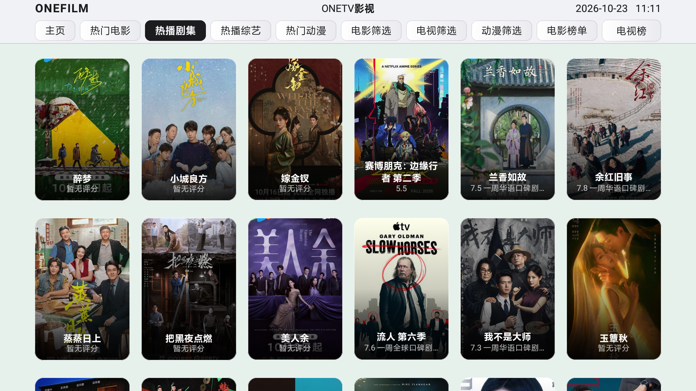 |

| Tìm kiếm | Kết quả tìm kiếm |
|---|---|
| 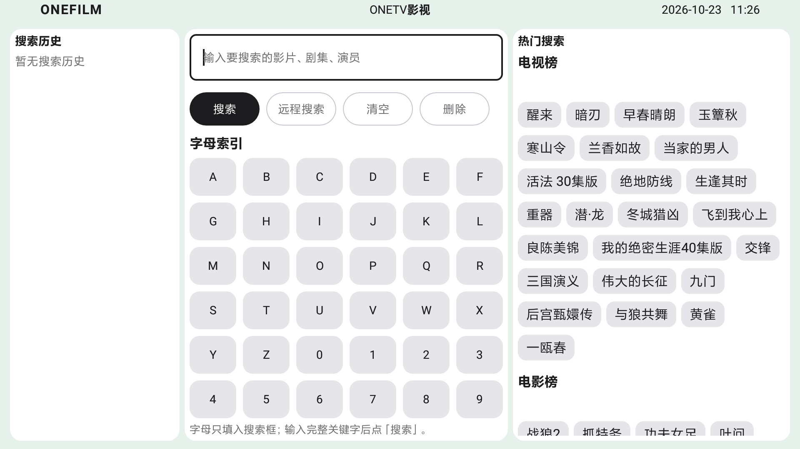 | 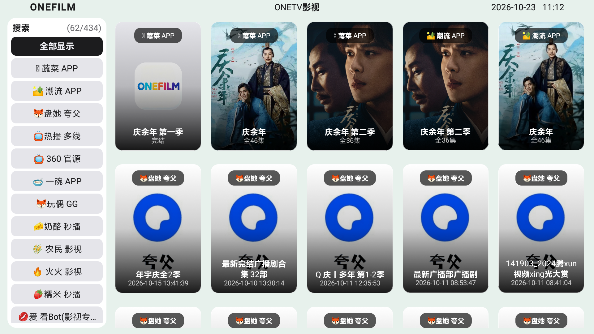 |

| Lịch sử | Cài đặt |
|---|---|
| 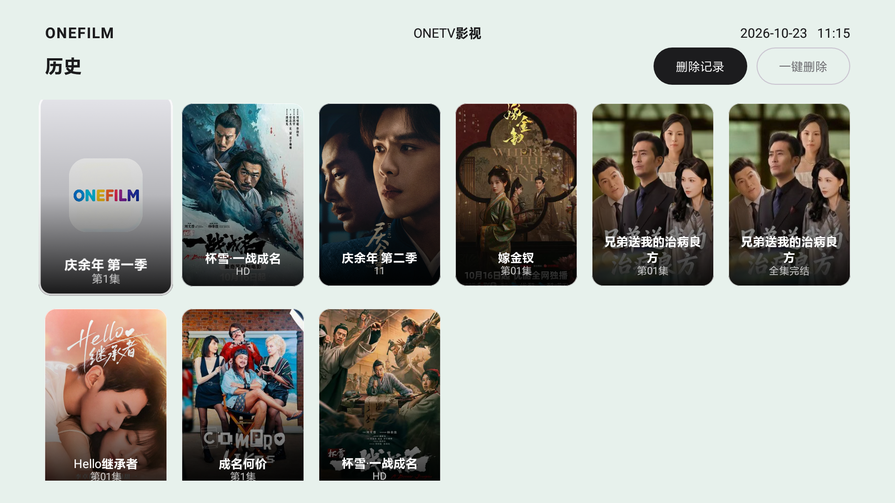 | 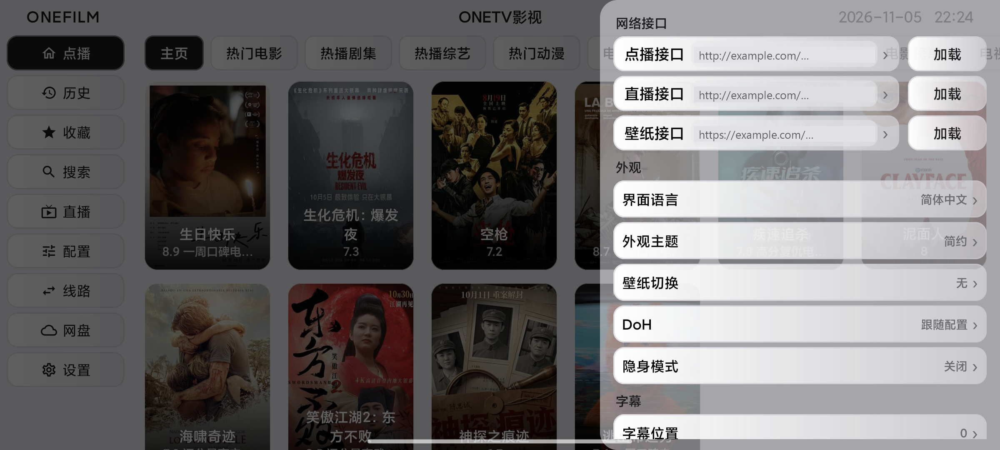 |

| Chi tiết | Phát |
|---|---|
| 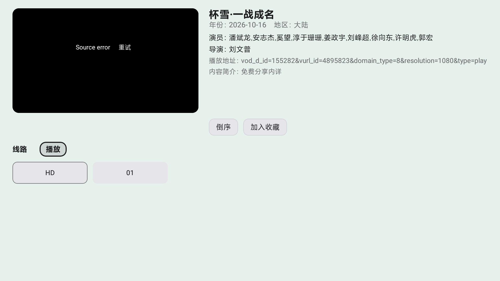 |  |

### Giao diện trên điện thoại

| Trang chủ | Tìm kiếm |
|---|---|
| 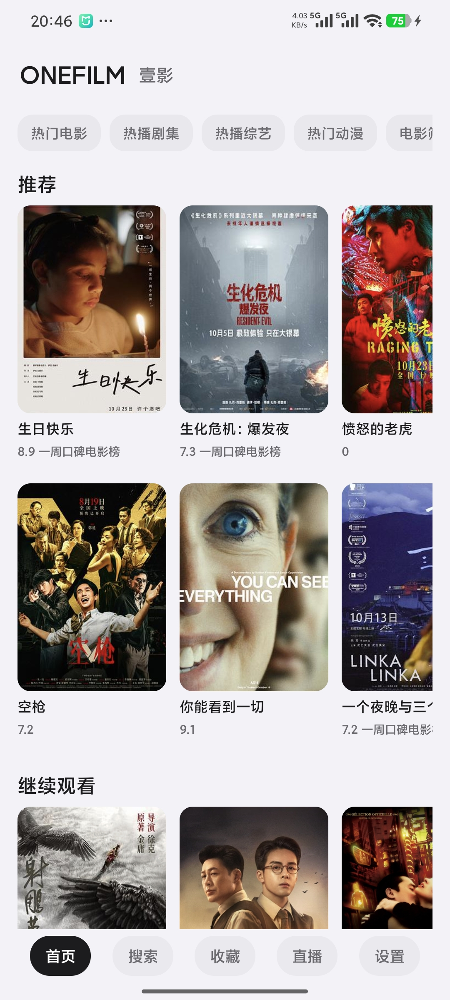 | 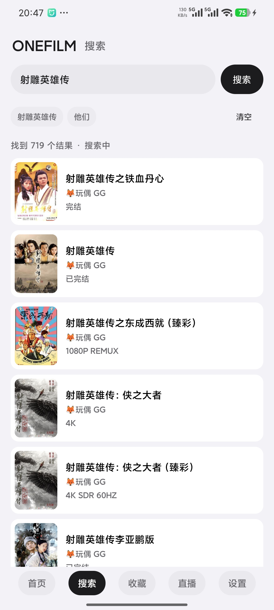 |

| Yêu thích | Lịch sử |
|---|---|
| 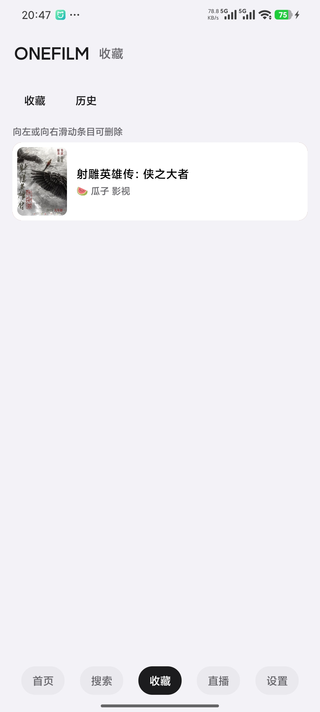 | 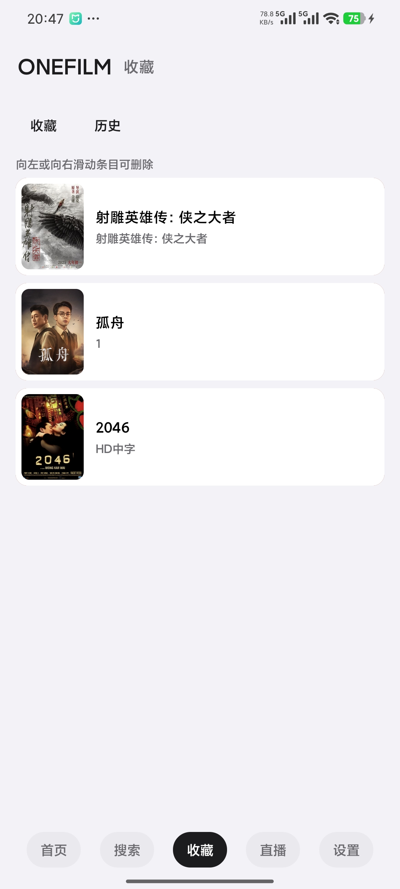 |

| Chi tiết phim | Lọc theo phân loại |
|---|---|
| 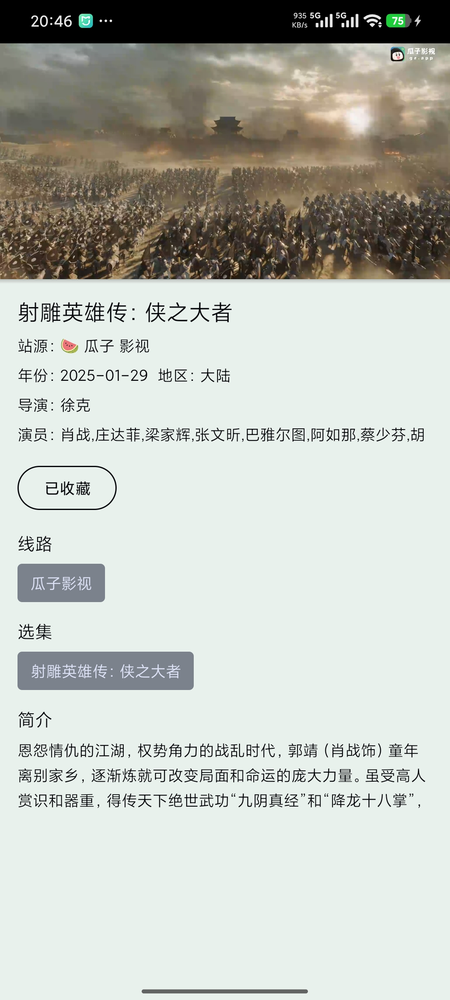 | 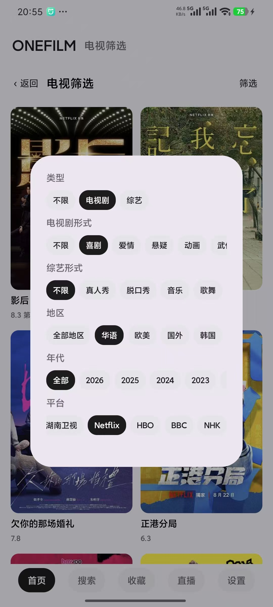 |

| Cài đặt | Phân loại |
|---|---|
| 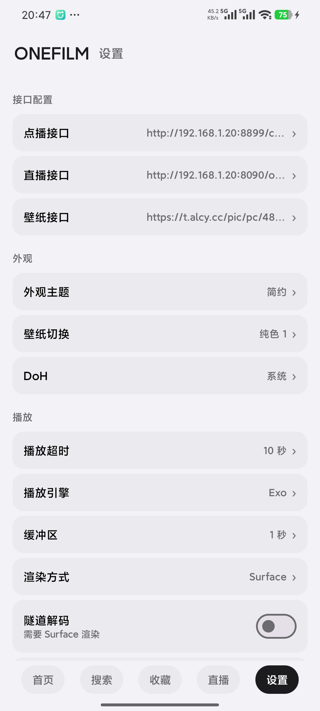 | 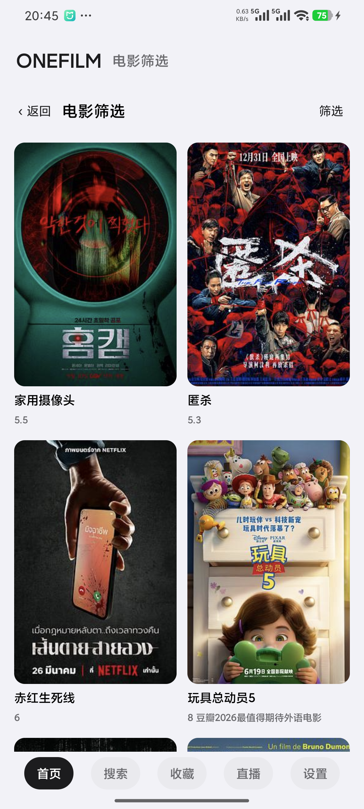 |

> Ảnh chụp chỉ dùng để minh hoạ giao diện và kiểm thử trong quá trình phát triển; phim, poster và địa chỉ nguồn đều là nội dung demo; bản phát hành chính thức không tích hợp sẵn bất kỳ tài nguyên phim hay nguồn khả dụng nào.

## Lưu ý

OneFilm **không cung cấp, không tích hợp sẵn và không kèm theo** bất kỳ nội dung phim, nguồn trực tiếp hay nguồn xem theo yêu cầu/trực tiếp khả dụng nào. Đây chỉ là lớp vỏ của trình phát: người dùng cần tự chuẩn bị và cấu hình nguồn nội dung hợp pháp, đồng thời tự chịu trách nhiệm về nguồn mình sử dụng. Không dùng phần mềm này để phát tán nội dung xâm phạm bản quyền hoặc cho mục đích vi phạm pháp luật địa phương.

## Nguồn gốc và bản quyền

OneFilm được phát triển lại dựa trên nhánh `fongmi` của [FongMi/TV](https://github.com/FongMi/TV), tiếp tục sử dụng giấy phép **GPL-3.0**.

- Dự án gốc: [FongMi/TV](https://github.com/FongMi/TV)
- Commit khởi đầu của dự án gốc: `0af3b31a1783b8fa4f0ce12e52ac9fad78ddfb1e`
- Giấy phép: [LICENSE.md](LICENSE.md)
- Thông báo của bên thứ ba và dự án gốc: [NOTICE](NOTICE)

Cảm ơn dự án gốc và toàn bộ những người đóng góp mã nguồn mở. OneFilm giữ lại nguồn gốc và thông báo bản quyền của dự án gốc, đồng thời giữ quyền tự cấu hình nguồn hợp pháp của người dùng.
