[简体中文](README.md) · **繁體中文** · [English](README.en.md) · [Tiếng Việt](README.vi.md) · [ไทย](README.th.md)

# 壹影 OneFilm

> **把電視，變成全家人的私人影院。**

壹影 OneFilm 是一款為 **Android TV、電視盒子和手機大螢幕** 打造的影視播放器。它把隨選影片、直播、聚合搜尋、收藏續播、字幕、彈幕和遙控器操作收進一個清爽的大螢幕介面裡，讓你不必在多個 App 之間來回切換。

如果你手上有合法的影視介面、TVBOX 相容設定或直播源，壹影就是那個負責把內容「好好呈現出來」的播放器：海報牆夠大、搜尋夠快、遙控器夠順手，長輩和孩子也能輕鬆使用。

## 一眼看懂

- **一個入口，裝下想看的內容**：電影、劇集、綜藝、動漫、直播，在同一個電視介面裡瀏覽。
- **TVBOX 相容介面播放**：支援匯入 TVBOX / CatVod 風格的影視與直播介面，介面由使用者自行提供。
- **為電視而生**：大字級、大海報、明確的焦點高亮，坐在沙發上用遙控器就能完成所有操作。
- **好看，也好用**：簡潔明亮的介面、流暢的卡片動效、沒有多餘打擾，打開就能看。
- **看得舒服**：支援字幕、音軌、畫面比例、倍速、彈幕和多種播放設定。
- **下一次接著看**：收藏、觀看紀錄和續播紀錄都在，換集、換線路不用重新找。
- **五種語言，隨手切換**：简体中文、繁體中文、English、Tiếng Việt、ไทย，設定裡一鍵切換。

## 它能做什麼

### 客廳裡的影視入口

把常用的影視介面集中到一個播放器裡。首頁是清晰的海報牆，分類、篩選、榜單和搜尋都在手邊，找片不需要複雜操作。

### 隨選與直播，一機搞定

電影、電視劇、綜藝、動漫可以按分類瀏覽；直播頻道可以按頻道組切換。一個 App，涵蓋一家人不同的觀看習慣。

### 聚合搜尋，少走冤枉路

輸入片名就能同時搜尋多個內容來源，結果按來源顯示，哪條線路能播、哪條更順，一眼就能判斷。

### 大螢幕遙控器體驗

所有按鈕和卡片都為遙控器最佳化：焦點清楚、移動順滑、返回不迷路。不是把介面簡單放大，而是真正適合電視的互動。

### 看得久，也看得舒服

支援字幕樣式與位置調整、音軌切換、畫面比例、播放速度、彈幕開關等常用功能；全螢幕播放時控制項自動隱藏，確認鍵暫停，左右鍵快進後退。

### 個人化你的電視

主題、桌布、介面和播放偏好都可以按自己的習慣調整。簡潔、明亮、暗黑，喜歡哪種就用哪種。

### 五種介面語言

選單、設定、播放器控制、網路硬碟與提示訊息均已支援 **简体中文、繁體中文、English、Tiếng Việt、ไทย**。在「設定 → 語言」中切換後立即生效，TV 端與手機端使用同一套文案；切換語言不會影響介面設定、收藏和觀看紀錄。

## 適合這些情境

- 家裡有 Android TV 或電視盒子，希望用一個統一入口看電影、追劇、看直播。
- 已經有合法的 TVBOX / 影視介面，但想要一個更漂亮、更順手的播放器。
- 不想研究複雜設定，只想安裝、匯入介面，然後坐下來看。
- 喜歡大螢幕海報牆、遙控器焦點和「打開就能繼續看」的體驗。

## 開始使用

1. 從 [GitHub Releases](https://github.com/Viciy2023/Onefilm/releases/latest) 下載最新版 APK：
   - 電視/盒子：`OneFilm-TV-*.apk`
   - 手機/平板：`OneFilm-Mobile-*.apk`
2. 安裝後打開壹影。
3. 在「介面設定」或「設定」中匯入你自己的合法影視/直播介面。
4. 回到首頁，搜尋或瀏覽想看的內容。

> 系統需求：**Android 7.0 以上**。

## 介面預覽

| 首頁 | 分類 |
|---|---|
|  | 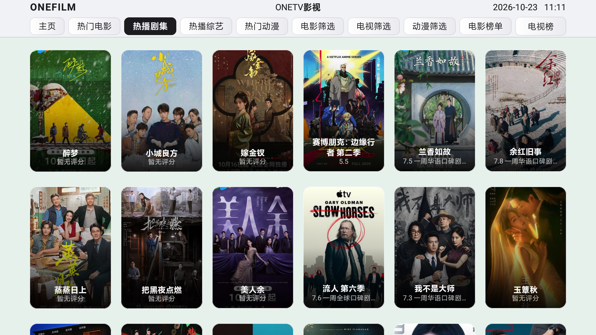 |

| 搜尋 | 搜尋結果 |
|---|---|
| 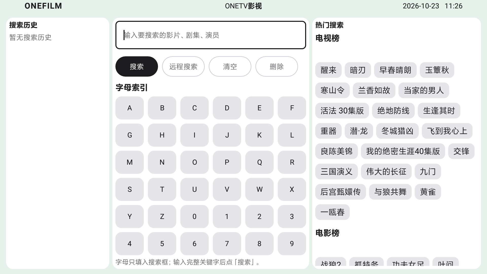 | 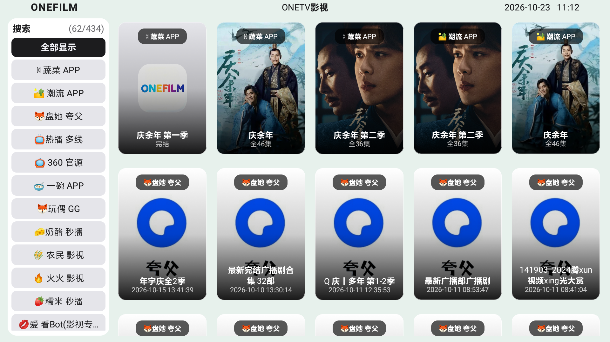 |

| 歷史 | 設定 |
|---|---|
| 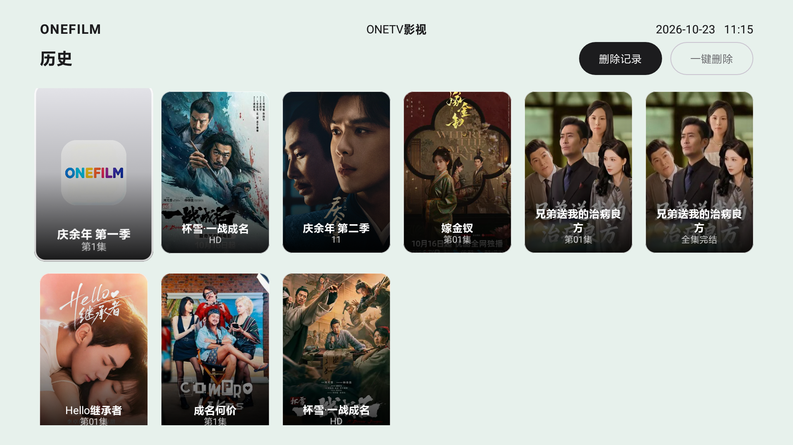 | 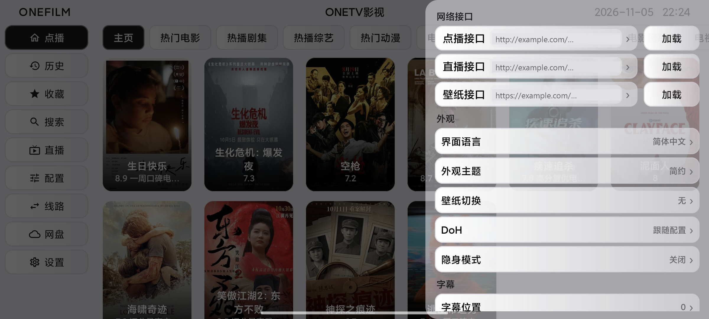 |

| 詳情 | 播放 |
|---|---|
| 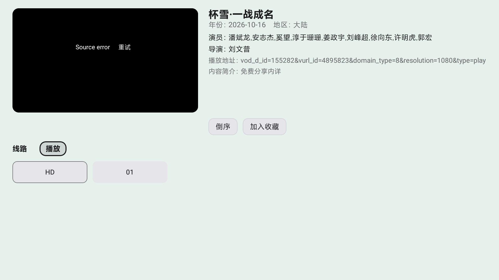 |  |

### 手機版介面

| 首頁 | 搜尋 |
|---|---|
| 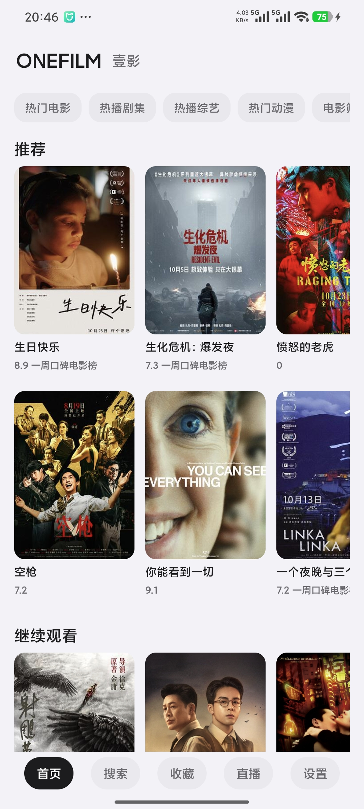 |  |

| 收藏 | 歷史 |
|---|---|
| 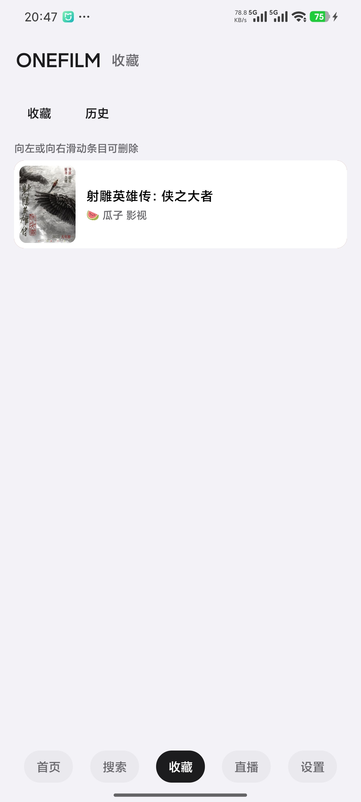 | 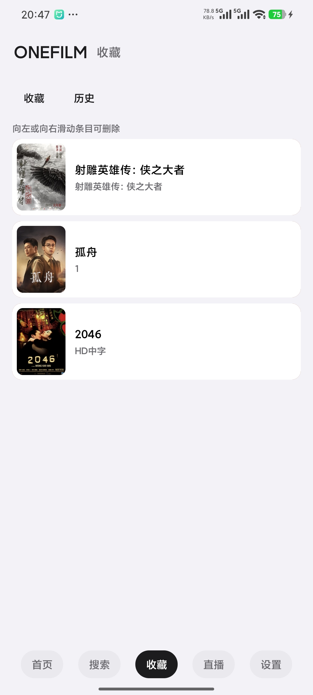 |

| 電影詳情 | 分類篩選 |
|---|---|
| 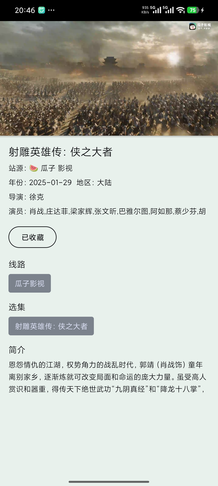 | 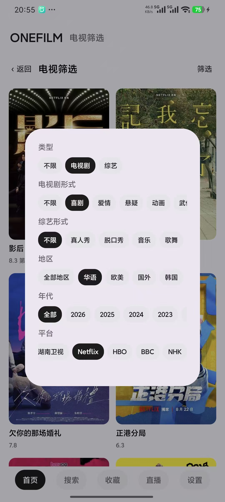 |

| 設定 | 分類 |
|---|---|
| 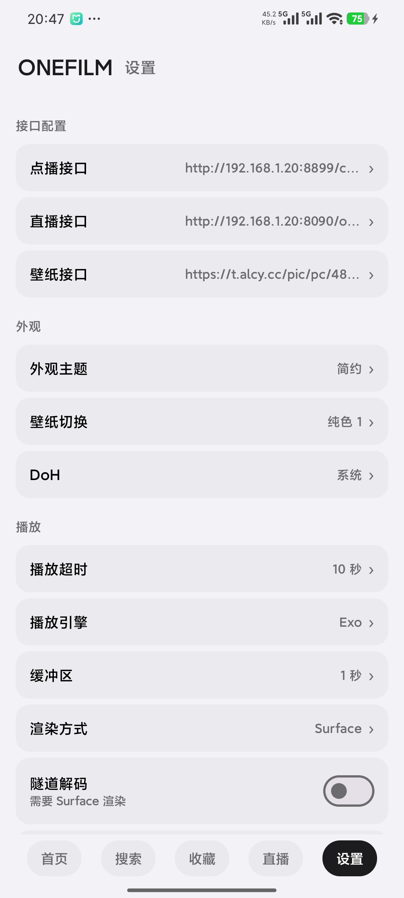 | 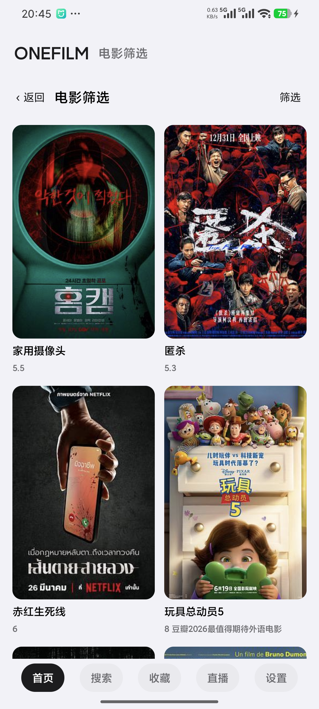 |

> 截圖僅用於展示介面與開發測試，影片、海報和介面位址均為示範內容；正式發布版不內建任何影視資源或可用介面。

## 說明

壹影 OneFilm **不提供、不內建、不附帶**任何影視內容、直播源或可用的隨選/直播介面。它只是一個播放器外殼：使用者需要自行準備並設定合法的內容介面，並對自己使用的內容來源負責。請勿將本軟體用於傳播侵權內容或違反當地法律法規的用途。

## 來源與版權

壹影 OneFilm 基於 [FongMi/TV](https://github.com/FongMi/TV) 的 `fongmi` 分支二次開發，繼續使用 **GPL-3.0** 授權條款。

- 上游專案：[FongMi/TV](https://github.com/FongMi/TV)
- 上游初始提交：`0af3b31a1783b8fa4f0ce12e52ac9fad78ddfb1e`
- 授權條款：[LICENSE.md](LICENSE.md)
- 第三方與上游聲明：[NOTICE](NOTICE)

感謝上游專案與所有開源貢獻者。壹影保留上游來源與版權聲明，也保留使用者自行設定合法介面的自由。
