[简体中文](README.md) · **繁體中文** · [English](README.en.md) · [Tiếng Việt](README.vi.md) · [ไทย](README.th.md)

# 壹影 OneFilm

> **把電視，變成全家人的私人影院。**

壹影 OneFilm 是一款為 **Android TV、電視盒子和手機大螢幕** 打造的影視播放器。它把隨選影片、直播、聚合搜尋、收藏續播、字幕、彈幕和遙控器操作收進一個清爽的大螢幕介面裡，讓你不必在多個 App 之間來回切換。

如果你手上有合法的影視介面、TVBOX 相容設定或直播源，壹影就是那個負責把內容「好好呈現出來」的播放器：海報牆夠大、搜尋夠快、遙控器夠順手，長輩和孩子也能輕鬆使用。

🌐 **專案主頁**：<https://film.onetv.de5.net/>

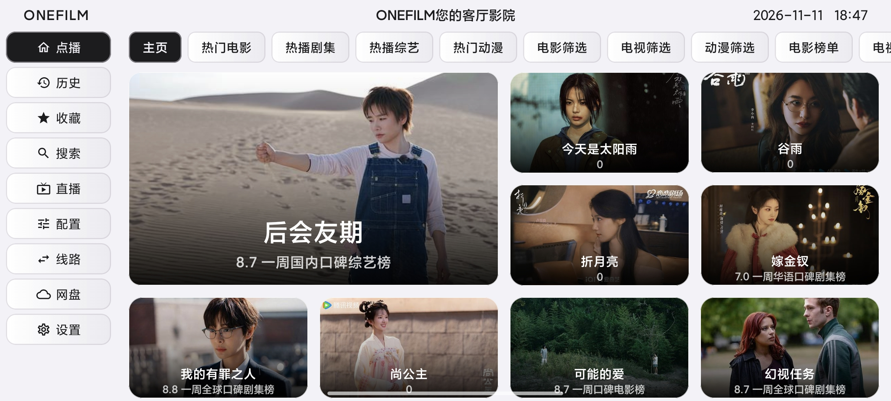

- **AI 即時字幕同步翻譯**：本機辨識外語語音並自動翻譯成中文字幕，看日劇、美劇也能同步顯示雙語字幕。
## 一眼看懂

- **一個入口，裝下想看的內容**：電影、劇集、綜藝、動漫、直播，在同一個電視介面裡瀏覽。
- **TVBOX 相容介面播放**：支援匯入 TVBOX / CatVod 風格的影視與直播介面，介面由使用者自行提供。
- **為電視而生**：大字級、大海報、明確的焦點高亮，坐在沙發上用遙控器就能完成所有操作。
- **好看，也好用**：簡潔明亮的介面、流暢的卡片動效、沒有多餘打擾，打開就能看。
- **看得舒服**：支援字幕、音軌、畫面比例、倍速、彈幕和多種播放設定。
- **影片廣告過濾**：自動辨識並跳過 m3u8 貼片廣告，規則未涵蓋的來源也能靠 URL 特徵與 PTS 時間軸連續性兜底。
- **彈幕**：相容常規彈幕介面，也可自訂彈幕 API；播放時依片名與集數自動匹配，支援公益或自建節點。
- **下一次接著看**：收藏、觀看紀錄和續播紀錄都在，換集、換線路不用重新找。
- **五種語言，隨手切換**：简体中文、繁體中文、English、Tiếng Việt、ไทย，設定裡一鍵切換。
- **海報兩種樣式**：豎版海報牆之外新增橫版 16:9 樣式；在「設定 → 外觀 → 海報樣式」切換後，首頁、分類、搜尋、收藏、歷史統一生效。

## 它能做什麼

### AI 即時字幕同步翻譯

播放外語影片時，OneFilm 可以在本機即時辨識語音，並把辨識結果翻譯成中文字幕——看日本電影、英文電影，也能同步看到我們自己的中文字幕。

- **本機辨識**：辨識模型（國語/粵語/英語/日語/韓語/德語/法語/西班牙語/俄語）下載後在本機執行，音訊不會上傳。
- **翻譯可選**：有道翻譯（免設定）、自建 MTranServer，或任意 OpenAI 相容大模型；雙語或僅譯文可切換。
- **顯示可調**：字幕位置、顏色（白/紅/綠/黃/隨機）、大小、描邊、加粗、字型，設定面板與播放器彈窗共用同一套參數。
- **依語種下載**：每種語言一個模型包，用哪個下哪個；粵語/日語為離線整段辨識，延遲略高於串流模型。

**效能與模型選擇**

- 每種語言都有「標準」與「精簡」兩套模型可選：標準模型精度較高，適合手機、平板與效能較好的機上盒；精簡模型體積小、運算需求低，適合 4 核、2GB 記憶體的電視。
- **低效能電視不建議使用標準模型**：實測 4 核 Amlogic、2GB 記憶體的電視跑 162MB 普通話標準模型時 RTF 約 2.3（速度只有即時的一半），音訊佇列長期滿載、開始丟幀，字幕整體落後十多秒且與畫面對不上；記憶體壓力升高時，系統會直接終止 App 進程。
- 建議：
  - 電視端優先選「普通話（精簡）」或「英語（精簡）」；
  - 首次使用先在設定裡下載對應精簡模型，再開啟「即時辨識」；
  - 若播放中電視變卡或 App 被終止，先降到精簡模型，並關閉其他背景應用；
  - 手機／高效能裝置再切回標準模型以換取更高辨識精度；
  - 目前僅普通話、英語提供兩套模型，德語、法語、西班牙語、韓語、俄語、粵語、日語官方只有一套（日語已是官方最小體積）。

### 彈幕

相容常規彈幕介面，也可以在設定裡填寫自訂彈幕 API。播放時依片名與集數自動匹配，支援公益節點或自建服務。

### 客廳裡的影視入口

把常用的影視介面集中到一個播放器裡。首頁是清晰的海報牆，分類、篩選、榜單和搜尋都在手邊，找片不需要複雜操作。

### 隨選與直播，一機搞定

電影、電視劇、綜藝、動漫可以按分類瀏覽；直播頻道可以按頻道組切換。一個 App，涵蓋一家人不同的觀看習慣。

### 聚合搜尋，少走冤枉路

輸入片名就能同時搜尋多個內容來源，結果按來源顯示，哪條線路能播、哪條更順，一眼就能判斷。

### 大螢幕遙控器體驗

所有按鈕和卡片都為遙控器最佳化：焦點清楚、移動順滑、返回不迷路。不是把介面簡單放大，而是真正適合電視的互動。

### 看得久，也看得舒服

支援字幕樣式與位置調整、音軌切換、畫面比例、播放速度、彈幕開關等常用功能；全螢幕播放時控制項自動隱藏，確認鍵暫停，左右鍵快進後退。

### 個人化你的電視

主題、桌布、介面和播放偏好都可以按自己的習慣調整。簡潔、明亮、暗黑，喜歡哪種就用哪種。

### 五種介面語言

選單、設定、播放器控制、網路硬碟與提示訊息均已支援 **简体中文、繁體中文、English、Tiếng Việt、ไทย**。在「設定 → 語言」中切換後立即生效，TV 端與手機端使用同一套文案；切換語言不會影響介面設定、收藏和觀看紀錄。

## 適合這些情境

- 家裡有 Android TV 或電視盒子，希望用一個統一入口看電影、追劇、看直播。
- 已經有合法的 TVBOX / 影視介面，但想要一個更漂亮、更順手的播放器。
- 不想研究複雜設定，只想安裝、匯入介面，然後坐下來看。
- 喜歡大螢幕海報牆、遙控器焦點和「打開就能繼續看」的體驗。

## 開始使用

1. 從 [GitHub Releases](https://github.com/Viciy2023/Onefilm/releases/latest) 下載最新版 APK：
   - 電視/盒子：`OneFilm-TV-*.apk`
   - 手機/平板：`OneFilm-Mobile-*.apk`
   - 舊款電視/投影機（Android 5.0+）：`OneFilm-LITE-*.apk`
2. 安裝後打開壹影。
3. 在「介面設定」或「設定」中匯入你自己的合法影視/直播介面。
4. 回到首頁，搜尋或瀏覽想看的內容。

> 系統需求：TV / 手機版 **Android 7.0 以上**；**LITE 版 Android 5.0 以上**（API 21）。
>
> LITE 版說明：介面與業務和 TV 版同源，使用獨立套件名稱，可與 TV 版並存。為相容 Android 5.x，LITE 不含 Python 外掛、迅雷下載、投屏核心（TVBus）與 AV1/FFmpeg/IAMF 解碼擴充；首頁、搜尋、詳情、播放、收藏/歷史、直播等其餘功能與 TV 版一致，僅提供 `armeabi-v7a` 單一打包（約 18 MB）。

## 效能與記憶體

聚合搜尋會暫時建立大量腳本引擎，這部分記憶體管理直接決定低規裝置能否穩定運作。0.1.22 起，引擎回收改為「單站釋放 + 活躍保護 + 每 10 個站點兜底回收」，並補上逾時站點的強制回收。

同一台裝置、站點總數 313、連續 5 次完整搜尋的實測對比：

| 情境 | 優化前 | 優化後 |
|---|---:|---:|
| 搜尋期 Native 峰值 | 765 MB | 281 MB |
| 搜尋期總記憶體（PSS）峰值 | 1.06 GB | 537 MB |
| 高記憶體佔用持續時間 | 30–40 秒 | 4–6 秒 |
| 搜尋後播放 Native | 743 MB | 116 MB |
| 搜尋後播放總記憶體 | 1.01 GB | 366 MB |
| 退出播放後總記憶體 | 814 MB | 354 MB |
| 搜尋結束 60 秒後 Native | 177 MB | 115 MB |

補充說明：

- 播放器本身開銷很小：冷啟動直接播放只增加約 20 MB，壓力主要來自搜尋期的臨時引擎。
- 記憶體更早回落，代表 **2 GB / 3 GB 記憶體的電視與電視盒在連續搜尋、切換劇集時更不容易被系統回收**，卡頓與「看到一半被退出」的機率更低。
- 資料來自單台 11.4 GB 裝置、固定介面與固定關鍵字；不同站點數量、介面類型與網路狀況會有差異。

### 電視實測（2 GB 記憶體 / Android 9）

在 2 GB 記憶體的小米電視（Android 9）上，用同樣的 313 個站點重複 5 次搜尋 + 播放：

| 情境 | 應用 PSS | Native | 系統可用記憶體 |
|---|---:|---:|---:|
| 首頁閒置 | 104 MB | 20 MB | 800 MB |
| 5 次搜尋峰值 | 303 MB | 156 MB | 677 MB |
| 搜尋結束 60 秒 | 197 MB | 53 MB | 778 MB |
| 搜尋後播放 | 209 MB | 52 MB | 650–758 MB |
| 切到背景 | 192 MB | 53 MB | 700 MB |

全程沒有被系統殺掉程序，系統可用記憶體最低約 677 MB，代表在 2 GB 裝置上仍有足夠餘量。

## 介面預覽

| 首頁 | 分類 |
|---|---|
|  | 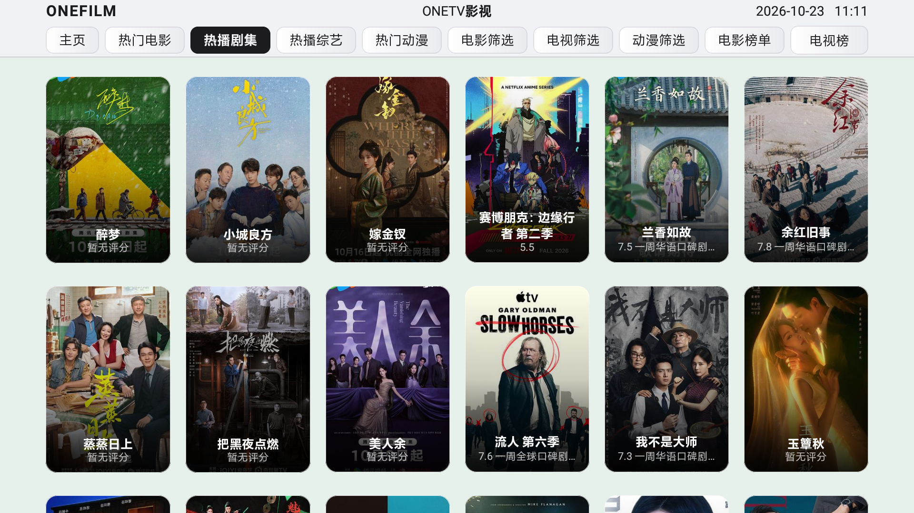 |

| 橫版首頁 | 橫版搜尋 |
|---|---|
| 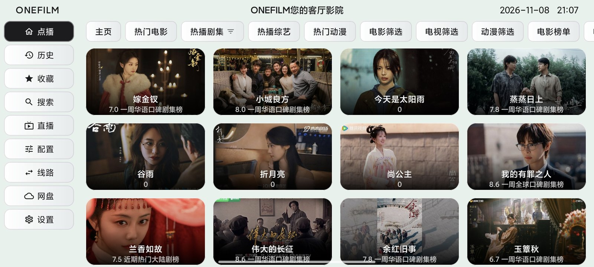 | 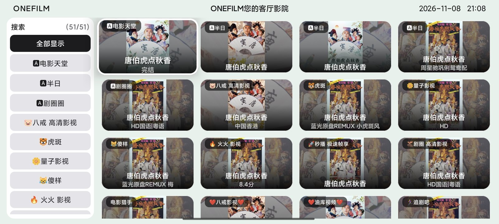 |

| 搜尋 | 搜尋結果 |
|---|---|
| 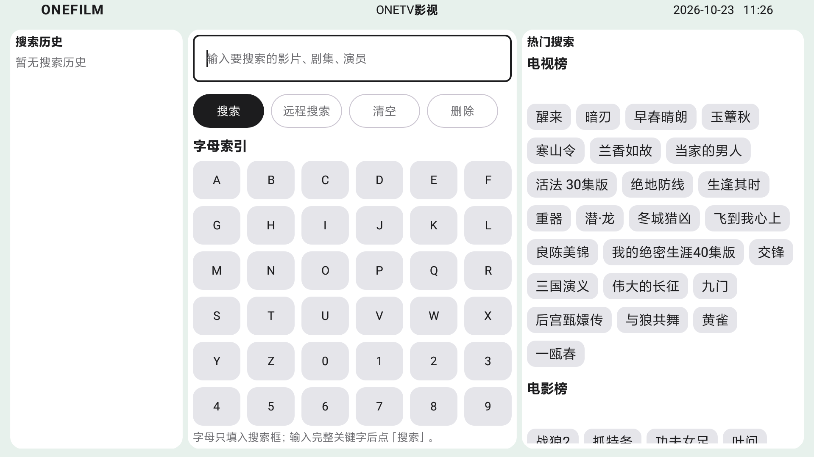 | 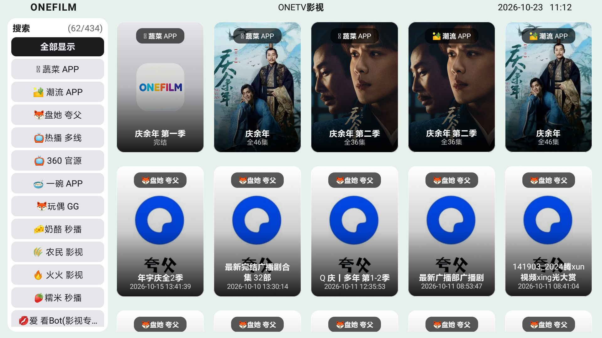 |

| 歷史 | 設定 |
|---|---|
| 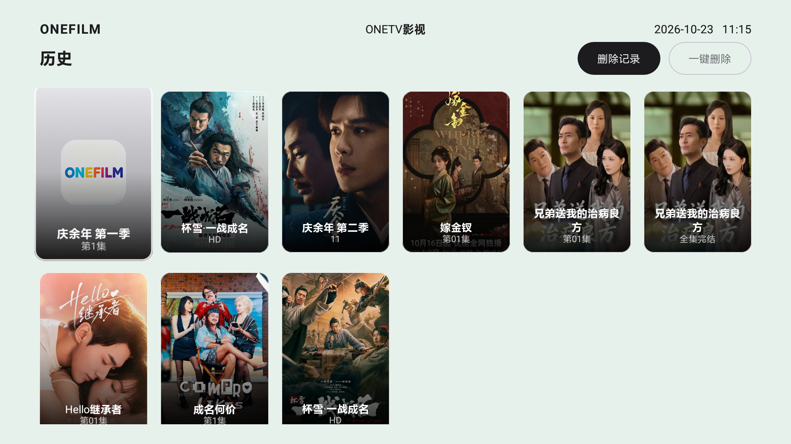 | 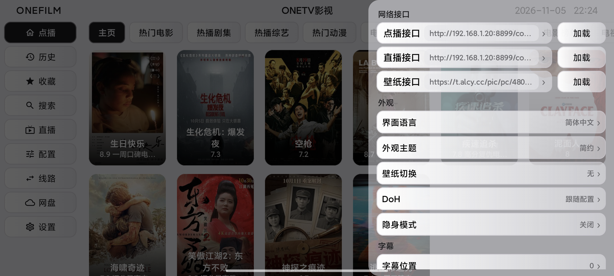 |

| 詳情 | 播放 |
|---|---|
| 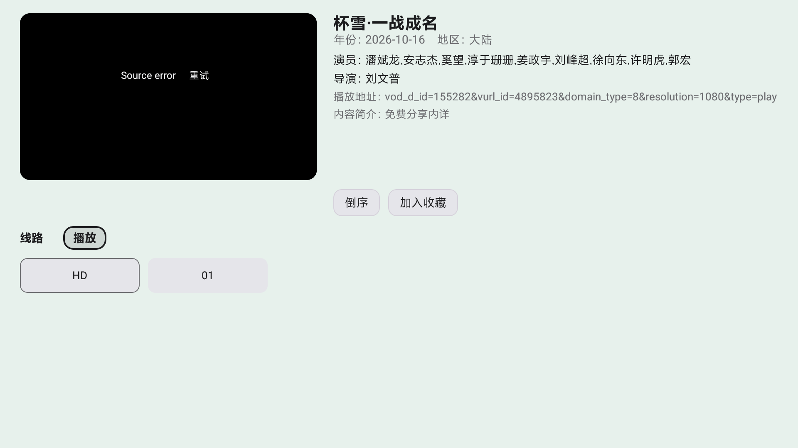 | 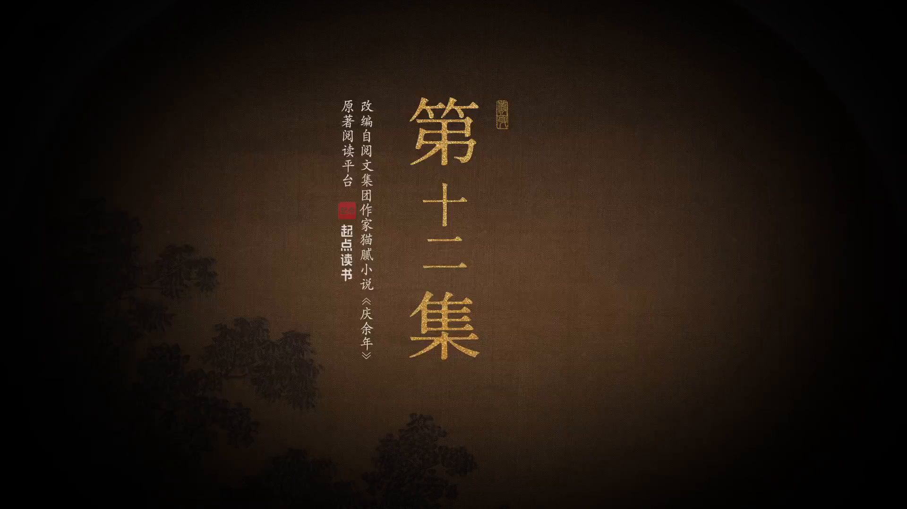 |

| 大屏彈幕 | 小窗彈幕 |
|---|---|
| 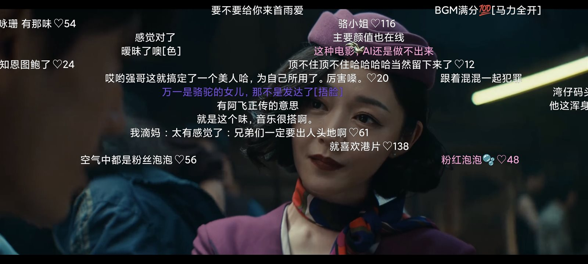 | 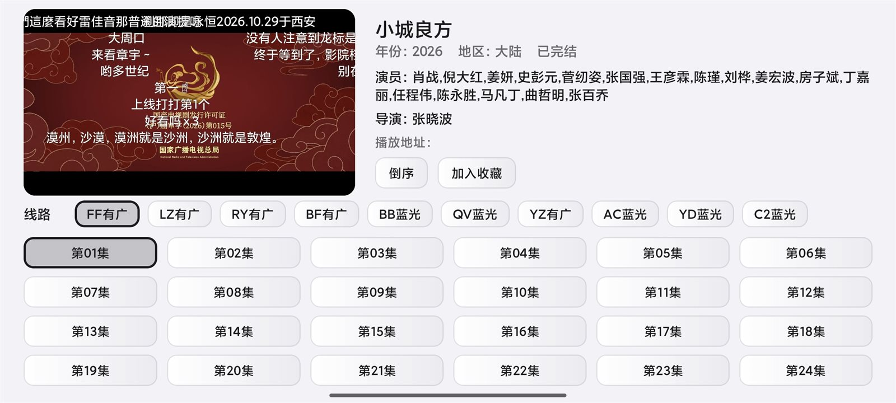 |

### 手機版介面

| 首頁 | 搜尋 |
|---|---|
| 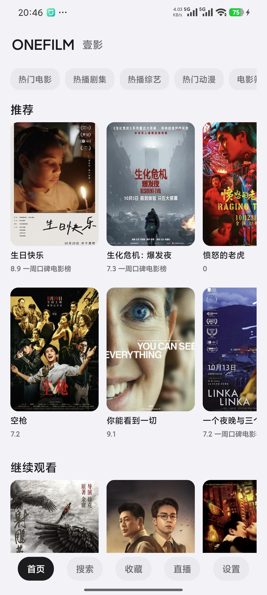 | 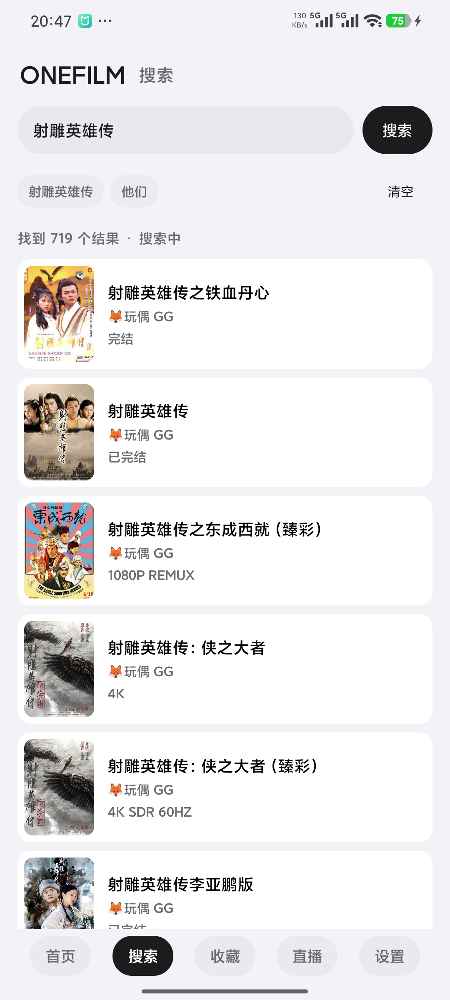 |

| 橫版首頁 | 橫版搜尋 |
|---|---|
| 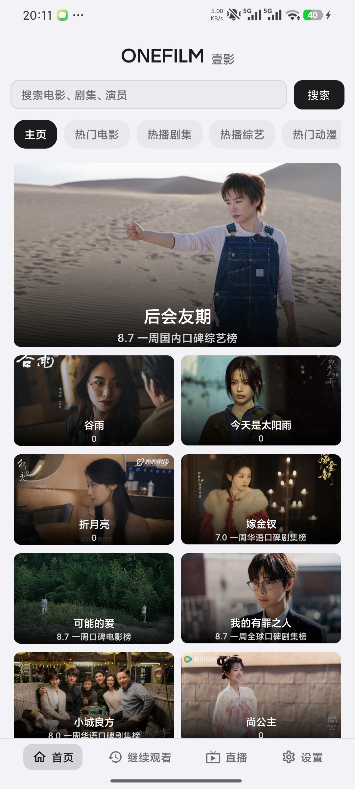 | 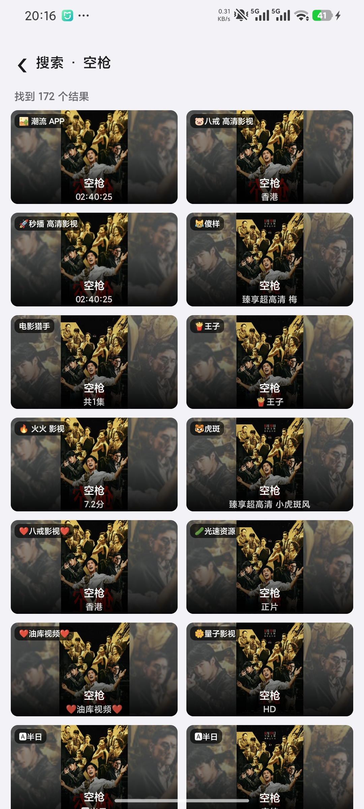 |

| 收藏 | 歷史 |
|---|---|
| 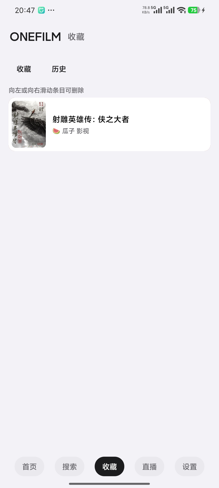 | 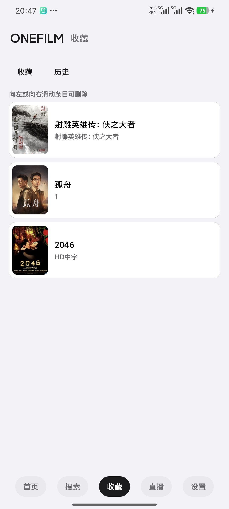 |

| 電影詳情 | 分類篩選 |
|---|---|
| 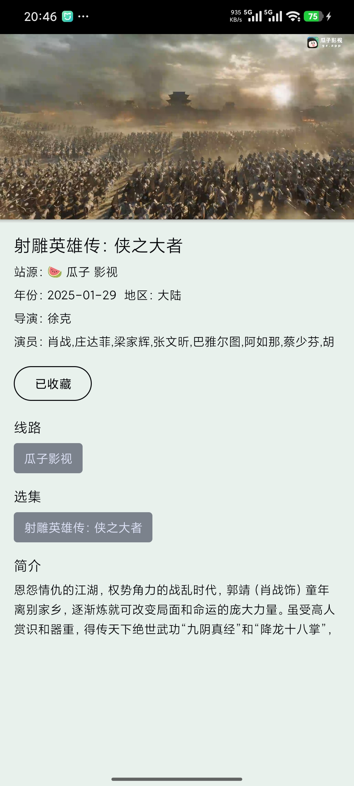 | 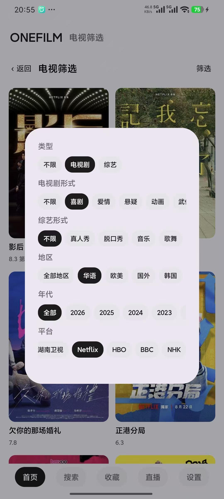 |

| 設定 | 分類 |
|---|---|
| 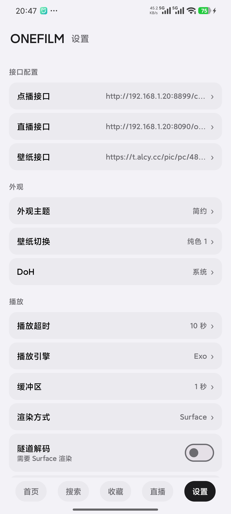 | 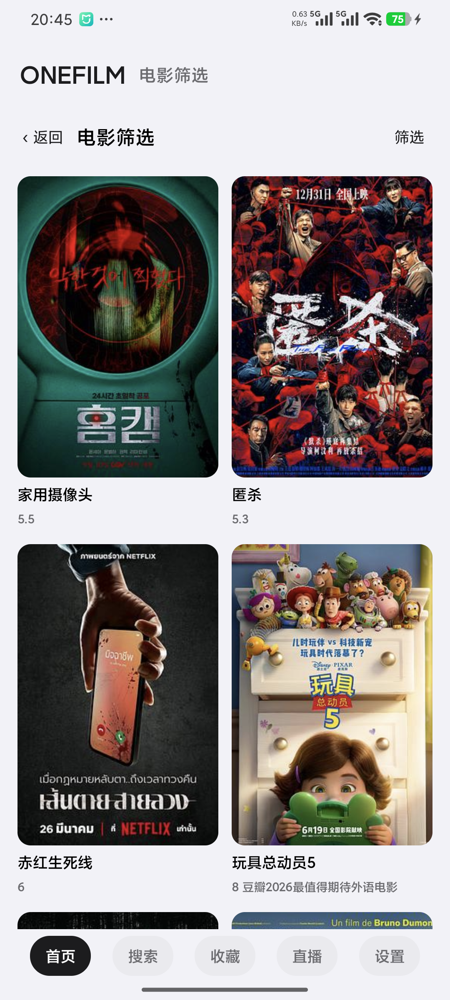 |

> 截圖僅用於展示介面與開發測試，影片、海報和介面位址均為示範內容；正式發布版不內建任何影視資源或可用介面。

## 說明

壹影 OneFilm **不提供、不內建、不附帶**任何影視內容、直播源或可用的隨選/直播介面。它只是一個播放器外殼：使用者需要自行準備並設定合法的內容介面，並對自己使用的內容來源負責。請勿將本軟體用於傳播侵權內容或違反當地法律法規的用途。

## 來源與版權

壹影 OneFilm 基於 [FongMi/TV](https://github.com/FongMi/TV) 的 `fongmi` 分支二次開發，繼續使用 **GPL-3.0** 授權條款。

- 上游專案：[FongMi/TV](https://github.com/FongMi/TV)
- 上游初始提交：`0af3b31a1783b8fa4f0ce12e52ac9fad78ddfb1e`
- 授權條款：[LICENSE.md](LICENSE.md)
- 第三方與上游聲明：[NOTICE](NOTICE)

感謝上游專案與所有開源貢獻者。壹影保留上游來源與版權聲明，也保留使用者自行設定合法介面的自由。
